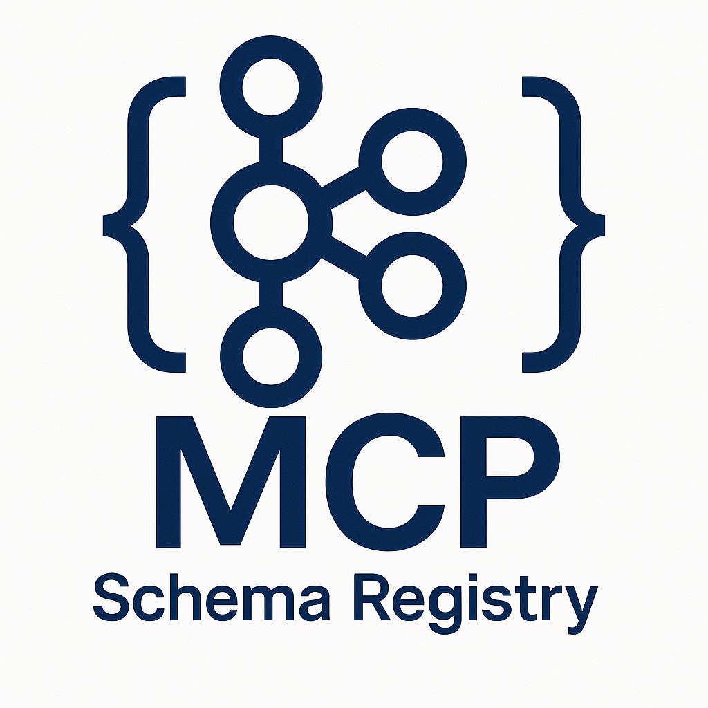

[](https://mseep.ai/app/aywengo-kafka-schema-reg-mcp)
[](https://opensource.org/licenses/MIT)
[](https://www.python.org/downloads/)
[](https://hub.docker.com/r/aywengo/kafka-schema-reg-mcp)
[](https://github.com/aywengo/kafka-schema-reg-mcp/releases)
[](https://github.com/aywengo/kafka-schema-reg-mcp/issues)
[](https://hub.docker.com/r/aywengo/kafka-schema-reg-mcp)
[](https://github.com/aywengo/kafka-schema-reg-mcp/graphs/commit-activity)
[](https://modelcontextprotocol.io)
[](https://archestra.ai/mcp-catalog/aywengo__kafka-schema-reg-mcp)

# Kafka Schema Registry MCP Server

A comprehensive **Model Context Protocol (MCP) server** that provides Claude Desktop and other MCP clients with tools for Kafka Schema Registry operations. Features advanced schema context support, multi-registry management, and comprehensive schema export capabilities.

<table width="100%">
<tr>
<td width="33%" style="vertical-align: top;">
<div style="background-color: white; padding: 20px; border-radius: 10px;">
  
</div>
</td>
<td width="67%" style="vertical-align: top; padding-left: 20px;">

> **🎯 True MCP Implementation**: Uses **FastMCP 4.1+** on **MCP Python SDK 2** with **MCP 2026-07-28** compliance. The same process negotiates `2025-11-25` with older clients. Fully compatible with Claude Desktop and other MCP clients using JSON-RPC over `stdio`.

**Latest Version:** [v3.0.0](CHANGELOG.md) | **Docker:** `aywengo/kafka-schema-reg-mcp:stable`
</td>
</tr>
</table>

> **🎛️ v3.0 editions.** The server runs as `viewer` (read-only: browse, export, compare, compatibility), `editor` (viewer + schema registration and evolution) or `admin` (full access: configuration, deletion, migration, bulk operations, disaster recovery). Plain `:latest` / `:stable` images are `viewer`; `-editor` and `-admin` tags and the Helm `edition` value opt into more. `SLIM_MODE` is a deprecated alias for `editor`. See [docs/editions.md](docs/editions.md) and [docs/v3-migration-guide.md](docs/v3-migration-guide.md).

## 📋 Table of Contents

- [🚀 Quick Start](#-quick-start)
- [✨ Key Features](#-key-features)
- [🛠️ Claude Code Skills](#️-claude-code-skills)
- [📦 Installation](#-installation)
- [⚙️ Configuration](#️-configuration)
- [💬 Usage Examples](#-usage-examples)
- [🔒 Authentication & Security](#-authentication--security)
- [📚 Documentation](#-documentation)
- [🧪 Testing](#-testing)
- [🚀 Deployment](#-deployment)
- [🤝 Contributing](#-contributing)
- [🆕 What's New](#-whats-new)

## 🚀 Quick Start

### 1. Run with Docker (Recommended)
```bash
# Latest stable release
docker pull aywengo/kafka-schema-reg-mcp:stable

# Viewer is the default; choose editor or admin explicitly when you need writes
docker run -e MCP_EDITION=editor -e SCHEMA_REGISTRY_URL=http://localhost:8081 aywengo/kafka-schema-reg-mcp:stable

# OR run with the full admin surface for administrators/SRE
docker run -e MCP_EDITION=admin -e SCHEMA_REGISTRY_URL=http://localhost:8081 aywengo/kafka-schema-reg-mcp:stable
```

### 2. Configure Claude Desktop
Copy a ready-to-use configuration from [`config-examples/`](config-examples/):

```bash
# macOS
cp config-examples/claude_desktop_stable_config.json ~/Library/Application\ Support/Claude/claude_desktop_config.json

# Linux  
cp config-examples/claude_desktop_stable_config.json ~/.config/claude-desktop/config.json
```

### 3. Start Using with Claude
Restart Claude Desktop and try these prompts:
- *"List all schema contexts"*
- *"Show me the subjects in the production context"* 
- *"Register a new user schema with fields for id, name, and email"*

## ✨ Key Features

- **🤖 Claude Desktop Integration** - Direct MCP integration with natural language interface
- **🏢 Multi-Registry Support** - Manage up to 8 Schema Registry instances simultaneously
- **📋 Schema Contexts** - Logical grouping for production/staging environment isolation
- **🔄 Schema Migration** - Cross-registry migration with backup and verification
- **📊 Comprehensive Export** - JSON, Avro IDL formats for backup and documentation
- **🔒 Production Safety** - VIEWONLY mode and per-registry access control
- **🔐 OAuth 2.1 Authentication** - Enterprise-grade security with scope-based permissions
- **📈 Real-time Progress** - Async operations with progress tracking and cancellation
- **🔗 Resource Linking** - HATEOAS navigation with enhanced tool responses
- **🧪 MCP 2026-07-28** - FastMCP 4 / MCP SDK 2; one process also serves `2025-11-25` clients
- **🎛️ Three editions** - `viewer` (38 tools), `editor` (41) and `admin` (67) from one codebase

> **📖 See detailed feature descriptions**: [docs/api-reference.md](docs/api-reference.md)

## 🛠️ Claude Code Skills

This project includes **5 specialized Claude Code skills** – 4 for automated schema development workflows plus 1 for schema context comparison (`/context-compare`, documented below):

### Available Skills

- **`/schema-generate`** - Generate production-ready Avro schemas from natural language
  ```
  /schema-generate event UserRegistered "user registration with userId, email, timestamp"
  ```

- **`/schema-evolve`** - Safely evolve schemas with automatic compatibility checking
  ```
  /schema-evolve user-profile "add optional phoneNumber field"
  ```

- **`/migration-plan`** - Create detailed migration plans between environments
  ```
  /migration-plan development staging
  ```

- **`/lint-and-test`** - Automated quality assurance workflows
  ```
  /lint-and-test quick        # Before commit (2-3s)
  /lint-and-test fix          # Auto-fix issues (20-30s)
  /lint-and-test pre-push     # Before push (10-15s)
  ```

### Getting Started with Skills

**Quick Start:** Read [`.claude-code/SKILLS_GUIDE.md`](.claude-code/SKILLS_GUIDE.md) - 5-minute tutorial

**Complete Reference:** [`.claude-code/skills/README.md`](.claude-code/skills/README.md) - Full documentation

**Setup Summary:** [`.claude-code/skills/README.md`](.claude-code/skills/README.md) - Configuration details

### Skills Features

- ✅ Natural language schema generation with templates
- ✅ Automatic compatibility checking (BACKWARD, FORWARD, FULL)
- ✅ Migration planning with rollback procedures
- ✅ Pre-commit and pre-push quality automation
- ✅ Integration with Black, Ruff, isort, Flake8
- ✅ Docker-based test execution
- ✅ Comprehensive error handling and auto-fix

**Try it now:** `/schema-generate event TestEvent "test with id and timestamp"`

## 📦 Installation

### Option A: Docker (Recommended)
```bash
# Viewer (default, 38 tools)
docker pull aywengo/kafka-schema-reg-mcp:stable

# Editor (41 tools) and admin (67 tools)
docker pull aywengo/kafka-schema-reg-mcp:stable-editor
docker pull aywengo/kafka-schema-reg-mcp:stable-admin

# Pin the release candidate and edition
docker pull aywengo/kafka-schema-reg-mcp:3.0.0-admin
```

#### Choosing an edition
`MCP_EDITION` selects the tool surface at startup. Plain tags run `viewer`.
```bash
# Read-only browsing
docker run -e SCHEMA_REGISTRY_URL=http://localhost:8081 aywengo/kafka-schema-reg-mcp:stable

# Schema registration and evolution
docker run -e MCP_EDITION=editor -e SCHEMA_REGISTRY_URL=http://localhost:8081 aywengo/kafka-schema-reg-mcp:stable

# Full surface, including deletion and migration
docker run -e MCP_EDITION=admin -e SCHEMA_REGISTRY_URL=http://localhost:8081 aywengo/kafka-schema-reg-mcp:stable
```

> **⚠️ `SLIM_MODE` is deprecated.** It is an alias for `MCP_EDITION=editor`
> and will be removed in 4.0.0. Do not set both variables.
>
> See [docs/editions.md](docs/editions.md) for the complete per-edition tool
> list and [docs/v3-migration-guide.md](docs/v3-migration-guide.md) for the
> upgrade path.

### Option B: Local Python
```bash
git clone https://github.com/aywengo/kafka-schema-reg-mcp
cd kafka-schema-reg-mcp
pip install -r requirements.txt
python kafka_schema_registry_unified_mcp.py
```

### Option C: Docker Compose
```bash
docker-compose up -d  # Includes Schema Registry for testing
```

> **📖 Detailed installation guide**: [docs/deployment.md](docs/deployment.md)

## ⚙️ Configuration

### Single Registry Mode
```bash
export SCHEMA_REGISTRY_URL="http://localhost:8081"
export SCHEMA_REGISTRY_USER=""           # Optional
export SCHEMA_REGISTRY_PASSWORD=""       # Optional
export VIEWONLY="false"                  # Production safety
export MCP_EDITION="viewer"              # viewer | editor | admin (default: viewer)
```

### Multi-Registry Mode (Up to 8 Registries)
```bash
# Development Registry
export SCHEMA_REGISTRY_NAME_1="development"
export SCHEMA_REGISTRY_URL_1="http://dev-registry:8081"
export VIEWONLY_1="false"

# Production Registry (with safety)
export SCHEMA_REGISTRY_NAME_2="production"  
export SCHEMA_REGISTRY_URL_2="http://prod-registry:8081"
export VIEWONLY_2="true"                     # Read-only protection
```

### Claude Desktop Configuration
Pre-configured examples available in [`config-examples/`](config-examples/):

| Configuration | Use Case | File |
|---------------|----------|------|
| **Production** | Stable Docker deployment | [`claude_desktop_stable_config.json`](config-examples/claude_desktop_stable_config.json) |
| **Multi-Environment** | DEV/STAGING/PROD registries | [`claude_desktop_multi_registry_docker.json`](config-examples/claude_desktop_multi_registry_docker.json) |
| **Local Development** | Python local execution | [`claude_desktop_config.json`](config-examples/claude_desktop_config.json) |
| **View-Only Safety** | Production with safety | [`claude_desktop_viewonly_config.json`](config-examples/claude_desktop_viewonly_config.json) |

> **📖 Complete configuration guide**: [config-examples/README.md](config-examples/README.md)

### Edition Configuration

An edition decides which tools are registered. Tools outside the active edition
are not listed and cannot be called, so they cost no context and cannot be
invoked by mistake.

| Edition | Tools | Use case |
|---|---|---|
| `viewer` (default) | 38 | Browse, export, compare, compatibility checks |
| `editor` | 41 | Viewer plus schema registration and evolution |
| `admin` | 67 | Full surface: configuration, deletion, migration, bulk operations |

```bash
export MCP_EDITION="admin"
```

Precedence: `MCP_EDITION` > `SLIM_MODE` alias > `MCP_EDITION_DEFAULT` >
`viewer`. Setting `MCP_EDITION` and `SLIM_MODE` together is a startup error.

**Resources are shared by every edition.** Read-only access stays available in
`viewer` through the `registry://`, `schema://` and `subject://` resources.

**VIEWONLY** is enforced at the HTTP session boundary. A read-only registry
rejects `PUT`, `DELETE` and non-read `POST` requests even if a write tool is
exposed by the edition.

## 📊 MCP Tools and Resources

The tool surface is generated from `tool_catalog.py`; the tables in
[docs/editions.md](docs/editions.md) are generated from the same catalog.

| Edition | Tools | Highlights |
|---|---|---|
| `viewer` | 38 | Registry info, subjects, schemas, compatibility, export, comparison, statistics, resources |
| `editor` | +3 | `register_schema`, `check_compatibility`, interactive schema registration |
| `admin` | +26 | Configuration, deletion, contexts, migration, bulk operations, workflows |

The server also exposes prompts (10) and resources (18, including templates).
See [docs/mcp-tools-reference.md](docs/mcp-tools-reference.md) for parameter
details.

## 💬 Usage Examples

### Schema Management
```bash
# In Claude Desktop, use natural language:
"Register a user schema with id, name, email fields"
"Check if my updated schema is compatible"
"Export all schemas from staging context"
"List subjects in production context"
```

### Multi-Registry Operations  
```bash
"Compare development and production registries"
"Migrate user-events schema from staging to production"
"Test connections to all registries"
"Show me registry statistics"
```

### Batch Operations
```bash
"Clear all schemas from test context"
"Export global schemas for backup"
"Count schemas across all contexts"
```

> **📖 More examples**: [examples/](examples/) | **📖 Use cases**: [docs/use-cases.md](docs/use-cases.md)

## 🔒 Authentication & Security

### OAuth 2.1 Support (Optional)
```bash
# Enable authentication
export ENABLE_AUTH=true
export AUTH_ISSUER_URL="https://your-oauth-provider.com"
export AUTH_AUDIENCE="your-client-id"
```

**Supported Providers:** Azure AD, Google OAuth, Keycloak, Okta, GitHub

**Permission Scopes:**
- `read` - View schemas, configurations
- `write` - Register schemas, update configs (includes read)
- `admin` - Delete subjects, full control (includes write + read)

### Production Safety Features
- **VIEWONLY Mode** - Prevent accidental changes in production
- **URL Validation** - SSRF protection with configurable localhost access
- **Scope-based Authorization** - Fine-grained tool-level permissions
- **Per-Registry Controls** - Independent safety settings

> **📖 Security guide**: [docs/deployment.md#security](docs/deployment.md#security)

## 📚 Documentation

| Guide | Description |
|-------|-------------|
| **[API Reference](docs/api-reference.md)** | Complete tool documentation with examples |
| **[Subject Aliasing](docs/subject-alias.md)** | How to add and remove subject aliases |
| **[Use Cases](docs/use-cases.md)** | Real-world scenarios and implementation patterns |
| **[Deployment Guide](docs/deployment.md)** | Docker, Kubernetes, cloud platforms, CI/CD |
| **[IDE Integration](docs/ide-integration.md)** | VS Code, Claude Code, Cursor setup |
| **[Configuration Examples](config-examples/)** | Ready-to-use Claude Desktop configs |
| **[Testing Guide](TESTING_SETUP_GUIDE.md)** | Comprehensive testing setup |
| **[Changelog](CHANGELOG.md)** | Version history and migration notes |
| **[v2.0.0 Highlights](README-v2.0.0-HIGHLIGHTS.md)** | Major version features |

### Additional Resources
- **[Examples](examples/)** - Usage examples and code samples
- **[Scripts](scripts/)** - Utility scripts and automation
- **[Helm Charts](helm/)** - Kubernetes deployment
- **[Tests](tests/)** - Test suites and validation

## 🧪 Testing

### Quick Test
```bash
cd tests/
./run_all_tests.sh --quick    # Essential tests
./run_all_tests.sh           # Complete test suite
```

### Docker Testing
```bash
python tests/test_docker_mcp.py
```

### MCP Inspector Tests (UI-driven)
```bash
# From repository root
cd inspector-tests

# Single registry (DEV)
./run-inspector-tests.sh stable

# Multi-registry (DEV + PROD)
./run-inspector-tests.sh multi

# Test a specific Docker tag
DOCKER_VERSION=latest ./run-inspector-tests.sh stable
```

> **📖 Testing guide**: [TESTING_SETUP_GUIDE.md](TESTING_SETUP_GUIDE.md)

## 🚀 Deployment

### Production Docker
```bash
# With docker-compose
docker-compose up -d

# Direct Docker  
docker run -d -p 38000:8000 \
  -e SCHEMA_REGISTRY_URL=http://registry:8081 \
  aywengo/kafka-schema-reg-mcp:stable
```

### Kubernetes
```bash
# Using Helm charts
helm install kafka-schema-mcp ./helm/kafka-schema-reg-mcp
```

> **📖 Deployment guide**: [docs/deployment.md](docs/deployment.md)

## 🤝 Contributing

We welcome contributions! Please see:
- **[Contributing Guidelines](.github/CONTRIBUTING.md)** 
- **[Code of Conduct](.github/CODE_OF_CONDUCT.md)**
- **[Development Setup](docs/deployment.md#local-development)**

### Quick Development Setup
```bash
git clone https://github.com/aywengo/kafka-schema-reg-mcp
cd kafka-schema-reg-mcp
python -m venv .venv && source .venv/bin/activate
pip install -r requirements.txt
python kafka_schema_registry_unified_mcp.py
```

## 🆕 What's New

### v3.0.0 (Latest)
- **🎛️ Editions** - `viewer` (38 tools), `editor` (41) and `admin` (67) from one image; `SLIM_MODE` is a deprecated alias for `editor`
- **📋 MCP 2026-07-28** - Dual-era protocol support with FastMCP native background tasks
- **🔒 FastMCP 4.1+** - Current MCP SDK 2 stack with the 2026 security fixes
- **🧭 MRTR workflows** - Guided schema evolution, migration, context reorganisation and disaster recovery
- **🚚 Migration guide** - [docs/v3-migration-guide.md](docs/v3-migration-guide.md)

### v2.1.x
- **🧭 Subject Aliasing** - New tools `add_subject_alias` and `delete_subject_alias`
- **🛠️ Fixes** - Evolution assistant and import interactive fixes
- **📦 Enhancements** - Continued MCP tool refinements and testing improvements
- **🗑️ Removed Deprecated Tools** - Custom task management tools removed in favor of FastMCP's built-in Docket system

### v2.0.x
- **🔒 Security Fixes** - Resolved credential exposure in logging
- **🤖 Interactive Schema Migration** - Smart migration with user preference elicitation
- **💾 Automatic Backups** - Pre-migration backup creation
- **✅ Post-Migration Verification** - Comprehensive schema validation  
- **🚀 FastMCP 2.8.0+ Framework** - Complete architecture upgrade
- **📊 MCP 2025-06-18 Compliance** - Latest protocol specification
- **🔐 OAuth 2.1 Generic Discovery** - Universal provider compatibility
- **🔗 Resource Linking** - HATEOAS navigation in tool responses

> **📖 Full changelog**: [CHANGELOG.md](CHANGELOG.md) | **📖 v2.0.0 features**: [README-v2.0.0-HIGHLIGHTS.md](README-v2.0.0-HIGHLIGHTS.md)

---
**🐳 Glama.ai:** 

<a href="https://glama.ai/mcp/servers/@aywengo/kafka-schema-reg-mcp">
  
</a>

---

**🐳 Docker Hub:** [`aywengo/kafka-schema-reg-mcp`](https://hub.docker.com/r/aywengo/kafka-schema-reg-mcp) | **📊 Stats:** 50+ MCP Tools (12 backward compatibility), 19 Resources, 8 Registries, OAuth 2.1, Multi-platform

**License:** MIT | **Maintainer:** [@aywengo](https://github.com/aywengo) | **Issues:** [GitHub Issues](https://github.com/aywengo/kafka-schema-reg-mcp/issues)
