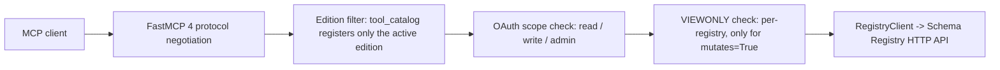
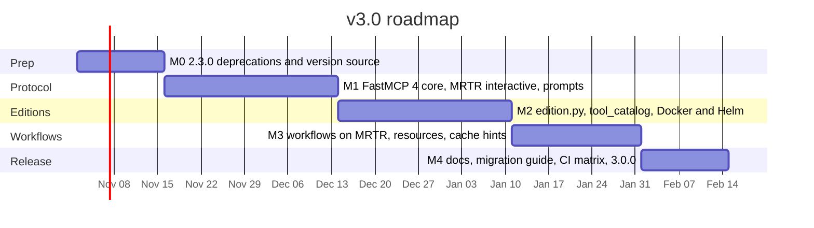

# v3.0 Design and Roadmap

> Status: implemented on `release/3.0` as `3.0.0`. Baseline: `2.2.2`; the
> FastMCP 4 work landed on top of the PR #180 compatibility branch.
> Companion documents: [CHANGELOG.md](../CHANGELOG.md), [v2 Migration Guide](v2-migration-guide.md).

v3.0 is a major release with two themes:

1. **Latest MCP protocol.** Move from MCP `2025-11-25` on FastMCP 3.x to MCP `2026-07-28` on
   FastMCP 4 / MCP Python SDK 2, while still serving `2025-11-25` clients from the same process.
2. **Three editions.** Split the server into a `viewer` edition (strictly read-only: browse,
   export, compare, compatibility checks), an `editor` edition (viewer plus schema evolution and
   schema registration) and an `admin` edition (full access: configuration, deletion, migration,
   bulk operations, disaster recovery), selected by one environment variable and shipped as
   three Docker tags from a single codebase.

The release also settles accumulated debt that blocks both themes: scattered version strings,
prompts that are defined but never exposed, resource URIs without handlers, and VIEWONLY
enforcement with gaps.

## Status

| Milestone | Status | Issue |
|---|---|---|
| M0 prep, deprecations, single version source (`2.3.0`) | ✅ complete | [#186](https://github.com/aywengo/kafka-schema-reg-mcp/issues/186) |
| M1 FastMCP 4 protocol core (`3.0.0-alpha.1`) | ✅ complete | [#187](https://github.com/aywengo/kafka-schema-reg-mcp/issues/187) |
| M2 editions and tool catalog (`3.0.0-beta.1`) | ✅ complete | [#188](https://github.com/aywengo/kafka-schema-reg-mcp/issues/188) |
| M3 workflows and resources (`3.0.0-rc.1`) | ✅ complete | [#189](https://github.com/aywengo/kafka-schema-reg-mcp/issues/189) |
| M4 docs and release (`3.0.0`) | ✅ complete | [#190](https://github.com/aywengo/kafka-schema-reg-mcp/issues/190) |

Umbrella tracker: [#191](https://github.com/aywengo/kafka-schema-reg-mcp/issues/191).

### M0 completion notes

- Single version source: `_version.py`; `pyproject.toml` uses `dynamic = ["version"]` with
  `[tool.hatch.version] path = "_version.py"`.
- Version consumed by `ping`, the compliance tool, `registry://info`, `remote-mcp-server.py`,
  the HTTP `User-Agent` strings and export metadata.
- Helm chart/appVersion/tag bumped to `2.3.0`.
- Startup deprecation notices added for `SLIM_MODE`, `READONLY*`, the five elicitation
  fallback tools, `set_default_registry`, the four workflow instance tools and the two
  `_tool`-suffixed names.
- Baseline test triage: `tests/test_mcp_compliance.py` now asserts `2025-11-25`;
  `tests/pytest.ini` uses `asyncio_mode = auto`; prompt structure tests aligned with the
  shipped prompts.
- `2.3.0` built and tagged locally. Image/chart publication is the external release step.

---

## 1. Goals and non-goals

### Goals

- Speak MCP `2026-07-28` (stateless requests, `server/discover`, multi-round-trip requests,
  tasks extension) and keep every `2025-11-25` client working with no configuration.
- Ship `viewer`, `editor` and `admin` editions with a least-privilege default. A client
  connected to a viewer edition cannot discover, let alone call, any tool that writes; a client
  connected to an editor edition cannot discover a destructive or configuration tool. The
  editor edition does include `register_schema`, which is a write (see section 2.4).
- One codebase, one Dockerfile, one Helm chart. Editions differ only by a startup setting.
- Make the tool catalog declarative so edition, OAuth scope, VIEWONLY enforcement, and MCP tool
  annotations come from one table instead of the 41 `if not SLIM_MODE:` blocks in
  `kafka_schema_registry_unified_mcp.py`.
- Remove process-local state that does not survive a stateless, multi-replica deployment
  (in-process workflow registry, mutable default registry).
- One version source consumed by code, image labels, and the Helm chart.
- Actually expose the prompts in `mcp_prompts.py` and make every `_links` URI resolvable.

### Non-goals

- No new Schema Registry features (for example an automated DR restore/import tool). Those are
  3.1 candidates; see section 5.
- No second repository or second installable package. Editions are a runtime profile.
- No change to the Schema Registry HTTP client layer in `schema_registry_common.py` beyond what
  centralised VIEWONLY enforcement needs.
- No removal of OAuth scopes. Scopes remain the per-user authorization layer inside an edition.

---

## 2. Editions design

### 2.1 Selection

- New module `edition.py` resolves the edition once at import time. Valid values, in order of
  privilege: `viewer` < `editor` < `admin`. Each edition is a strict superset of the one below
  it. Unknown values fail fast with a clear error.
- Two environment variables, because an environment lookup cannot tell an image default from
  an operator override: `MCP_EDITION` is the operator's explicit choice;
  `MCP_EDITION_DEFAULT` is what the image bakes in and is never set by operators. Resolution
  order:
  1. `MCP_EDITION` if set (explicit wins).
  2. else `SLIM_MODE=true` selects `editor` with a deprecation warning (its closest match:
     today's slim set includes `register_schema`; alias removed in 4.0).
  3. else `MCP_EDITION_DEFAULT` from the image.
  4. else `viewer` (least privilege; a plain image can never write).

  `SLIM_MODE=true` together with an explicit `MCP_EDITION` is an error, since the operator
  has stated two different intents. `SLIM_MODE` on top of an image default is fine: the
  existing `config-examples/claude_desktop_slim_mode_config.json`, which only sets
  `SLIM_MODE=true` against the plain image, must keep starting (as editor, with a warning), and
  is part of the alias test. The startup banner and the `ping` tool report the resolved
  edition and which rule chose it, so a misconfigured deployment is obvious.
- Docker tags published by [publish.yml](../.github/workflows/publish.yml):
  - `:3.0.0-viewer`, `:3.0-viewer`, `:3-viewer`, `:latest-viewer`, `:stable-viewer`
  - `:3.0.0-editor`, `:3.0-editor`, `:3-editor`, `:latest-editor`, `:stable-editor`
  - `:3.0.0-admin`, `:3.0-admin`, `:3-admin`, `:latest-admin`, `:stable-admin`
  - plain `:3.0.0`, `:3.0`, `:3`, `:latest`, `:stable` are aliases of the viewer image
  - The edition is baked in via `ENV MCP_EDITION_DEFAULT=...` (never `MCP_EDITION`) so it
    works without any extra client configuration and can still be overridden by `MCP_EDITION`
    or selected by the `SLIM_MODE` alias.
- Helm: new value `edition: viewer|editor|admin` in [helm/values.yaml](../helm/values.yaml).
  It selects the image tag suffix and sets `MCP_EDITION` in the ConfigMap.
  `values-remote-mcp.yaml` and `helm/examples/*` get an explicit `edition:` line.
- `config-examples/` gains `claude_desktop_viewer_config.json`,
  `claude_desktop_editor_config.json` (with `VIEWONLY=true` on production registries, since
  the editor edition can still register schemas) and `claude_desktop_admin_config.json`. The
  existing `claude_desktop_viewonly_config.json` is replaced by the viewer example, which is
  the intended way to get a read-only deployment in 3.0.

### 2.2 Why "not registered" rather than "registered but blocked"

MCP `2026-07-28` removes protocol-level sessions, and with them per-connection list results:
"List endpoints (`tools/list`, `resources/list`, `prompts/list`) no longer vary per-connection"
(SEP-2567); SEP-2549 adds `ttlMs` / `cacheScope` cache hints on those results. A catalog that
lists admin tools but rejects them per call would either defeat caching or leak the admin
surface to editor clients. Therefore:

- Tools, prompts and resources outside the active edition are **never registered** with FastMCP.
- Within an edition, OAuth scopes and VIEWONLY continue to gate individual calls.
- A smaller catalog also saves model context: the viewer edition exposes 39 tools and the
  editor edition 42, instead of the 75 registered today (44 editor-eligible, 26 admin-only,
  5 elicitation fallback).

### 2.3 Declarative tool catalog

New module `tool_catalog.py` holds one entry per tool:

```python
class Edition(IntEnum):
    VIEWER = 1
    EDITOR = 2
    ADMIN = 3


@dataclass(frozen=True)
class ToolSpec:
    name: str
    min_edition: Edition            # lowest edition that registers the tool
    scope: str                      # "read" | "write" | "admin"
    mutates: bool                   # subject to VIEWONLY enforcement
    annotations: ToolAnnotations    # readOnlyHint / destructiveHint / idempotentHint
    task: bool = False              # register with task=True (fastmcp-tasks)
```

`kafka_schema_registry_unified_mcp.py` iterates the catalog and registers only the entries whose
`min_edition` is less than or equal to the active edition. The same table drives:

- `SCOPE_DEFINITIONS[...]["includes"]` in `oauth_provider.py` (generated, no stale names).
- The centralised VIEWONLY check (section 2.5).
- `get_mcp_compliance_status` and `list_available_resources` output.
- `tests/test_editions.py`, which snapshots the exact catalog per edition.

### 2.4 Catalog by edition

Names below are the registered MCP tool names as of `2.2.2`, except where a 3.0 rename is noted.

**Viewer edition** (included in editor and admin), 39 tools. Every tool here is `read` scope
and `mutates=False`; a viewer deployment issues no write to any registry.

| Group | Tools |
|---|---|
| Protocol and discovery | `ping`, `get_mcp_compliance_status` (renamed from `get_mcp_compliance_status_tool`), `list_available_resources`, `suggest_resource_for_tool`, `generate_resource_templates`, `get_oauth_scopes_info` (renamed from `get_oauth_scopes_info_tool`), `test_oauth_discovery_endpoints` |
| Registry info | `list_registries`, `get_registry_info`, `test_registry_connection`, `test_all_registries`, `get_default_registry` |
| Read | `list_subjects`, `list_contexts`, `get_schema`, `get_schema_versions`, `get_schema_by_id`, `get_subjects_by_schema_id`, `get_global_config`, `get_mode`, `get_subject_config`, `get_subject_mode` |
| Compatibility | `check_compatibility`, `check_compatibility_interactive` |
| Export | `export_schema`, `export_subject`, `export_context`, `export_global`, `export_global_interactive` |
| Comparison | `compare_registries`, `compare_contexts_across_registries`, `find_missing_schemas` |
| Statistics | `count_contexts`, `count_schemas`, `count_schema_versions`, `get_registry_statistics` |
| Workflow definitions | `list_workflows`, `describe_workflow` (static definitions; see "Removed" below for the instance-inspection tools) |
| Evolution planning | `guided_schema_evolution` (returns a plan; registration stays in `register_schema`) |

Viewer prompts: `schema-getting-started`, `schema-compatibility`, `schema-export`,
`troubleshooting`, `quick-reference` (5).

Viewer resources: all `registry://`, `schema://` and `subject://` read resources (the full
resource set; no edition adds resources).

**Editor edition** (viewer set plus the following), 3 additional tools, 42 total

| Group | Tools |
|---|---|
| Registration | `register_schema`, `register_schema_interactive` |
| Subject aliases | `add_subject_alias` |

Editor prompts: viewer set plus `schema-registration`, `schema-evolution` (7 total).

**Admin edition** (editor set plus the following), 24 additional tools, 66 total

| Group | Tools |
|---|---|
| Context and subject lifecycle | `create_context`, `create_context_interactive`, `delete_context`, `delete_subject` |
| Configuration and mode | `update_global_config`, `update_subject_config`, `update_mode`, `update_subject_mode`, `delete_subject_alias` |
| Migration | `migrate_schema`, `migrate_context`, `migrate_context_interactive`, `migrate_schema_interactive` (new registration; function already exists in `interactive_tools.py`) |
| Batch and bulk | `clear_context_batch`, `clear_multiple_contexts_batch`, `bulk_operations_wizard`, `bulk_schema_update`, `bulk_schema_cleanup`, `bulk_schema_migration`, `bulk_configuration_update`, plus `preview_bulk_operation` (declared in `bulk_operations_mcp_integration.py` but never registered today; backed by `wizard._generate_preview`) |
| Guided workflows | `guided_schema_migration`, `guided_context_reorganization`, `guided_disaster_recovery` |

Admin prompts: all ten (adds `context-management`, `multi-registry`, `advanced-workflows`).

`PROMPT_REGISTRY` actually holds ten entries: `quick-reference` is appended after the initial
dictionary (`mcp_prompts.py` L1109). It is a condensed index of the other prompts and is
assigned `min_edition=VIEWER`, bringing the prompt counts to 5 viewer, 7 editor, 10 admin.
Registration iterates the catalog, not `PROMPT_REGISTRY`, so a prompt added to the registry
without an edition assignment fails `test_editions.py` rather than silently appearing.

**Removed in 3.0** (all editions):

- `submit_elicitation_response`, `list_elicitation_requests`, `get_elicitation_request`,
  `get_elicitation_status`, `cancel_elicitation_request` and the
  `elicitation://response/{request_id}` resource. These exist only to drive the home-grown
  elicitation fallback, which multi-round-trip requests replace (section 3.3). They survive
  as admin-only, deprecated entries in the `3.0.0-beta` catalog until the last three guided
  workflows are on MRTR (section 5, M2/M3).
- `workflow_status`, `get_workflow_status`, `list_available_workflows`, `abort_workflow`. The
  first three read `multi_step_manager.get_active_workflows()`, an in-process dictionary. Once
  workflow state travels in client-carried `request_state` (section 3.3) the server has no
  instance list to report, so these would return empty results. `list_available_workflows` and
  `get_workflow_status` also duplicate `list_workflows` and `workflow_status`. Aborting an MRTR
  workflow is the client declining to retry; a tool is not needed. Workflow progress is returned
  in each round-trip result instead.
- `set_default_registry`. It mutates a process-wide default, so under several replicas it
  changes one replica for every user. The default registry becomes configuration-only
  (`DEFAULT_REGISTRY` / `REGISTRIES_CONFIG`); `get_default_registry` stays as a read.
- `get_bulk_operation_status` and `cancel_bulk_operation` are **not** registered. Today
  (`bulk_operations_mcp_integration.py` L282-297) the first returns only a deprecation message
  and the second reports `cancelled` without cancelling or rolling anything back, so registering
  them would hand callers false confirmations. Bulk operations run as `fastmcp-tasks` tasks, so
  status and cancellation come from the tasks extension (`tasks/get`, `tasks/cancel`). The two
  stub handlers are deleted. If a bulk-specific rollback is wanted later it is a 3.1 item with
  its own design.

Boundary decisions worth stating explicitly:

- The viewer edition is the read-only deployment. It is the recommended way to give an AI
  assistant access to a production registry; `VIEWONLY` is unnecessary there because no
  registered tool can write (VIEWONLY stays meaningful for editor and admin deployments that
  mix writable and protected registries).
- `register_schema` is in editor because schema evolution ends with registering the next
  version. It is a `write`-scope, non-destructive, VIEWONLY-gated operation. This means an
  editor image pointed at a production registry without `VIEWONLY` can register schemas;
  the editor config example therefore sets `VIEWONLY` on production registries.
- `create_context` is admin. Contexts are a tenancy/organisation boundary, not part of a
  schema author's day-to-day evolution loop. The boundary is soft: Confluent Schema Registry
  creates a context implicitly when a subject is registered with a `:.ctx:` prefix, so
  `register_schema` in the editor edition can create contexts as a side effect. 3.0 accepts
  this and documents it; rejecting context-qualified subjects whose context does not exist is
  an opt-in follow-up.
- `check_compatibility` and all `export_*` stay `read` scope.
- `delete_subject_alias` moves from `write` to `admin` scope to match `add_subject_alias` being
  admin-edition only.
- The `_tool` suffix on `get_mcp_compliance_status_tool` and `get_oauth_scopes_info_tool` is
  dropped; a major release is the cheap moment to rename.

### 2.5 Relationship to VIEWONLY and OAuth scopes

The three mechanisms are orthogonal and layered:



- **Edition** decides what the server exposes. Set by the operator per deployment.
- **OAuth scope** decides what a given user may call inside the edition. The viewer edition
  only ever requires `read`; the editor edition never requires `admin`. Scope checks move from
  the custom `require_scopes`
  decorator (which lacks `functools.wraps` and reimplements token validation) to FastMCP 4's
  native scope checks, so clients receive insufficient-scope challenges naming the missing scope.
- **VIEWONLY** decides what a given registry accepts. It stays per registry and is enforced at
  two layers, because reading a single `registry` argument cannot cover every write
  destination: `migrate_schema` / `migrate_context` write to `target_registry`, bulk tools
  take registry lists, and the bulk wizard and guided workflows choose their destination during
  elicitation, possibly after an MRTR resume.
  - *Early check (deferred).* A per-tool middleware would need to resolve every write
    destination, including `target_registry`, bulk lists and MRTR-selected destinations.
    v3.0 does not ship that middleware; the catalog's `mutates` flag documents intent, and the
    definitive HTTP check below produces the error. A later version can add the early check.
  - *Definitive check (cannot be bypassed).* Direct registry writes are not confined to
    `schema_registry_common.py`: as of `2.2.2` there are 7 `session.post/put/delete` sites
    there, about 24 in `core_registry_tools.py`, 4 in `migration_tools.py`
    (`target_client.session.post/put`, L559-836), 1 in `batch_operations.py` (L320) and one
    `aiohttp` delete in `core_registry_tools.py` (L1779). A guard that only covers the common
    module would be bypassed by most of them. The boundary is therefore placed where all of
    them already pass: `RegistryClient.session` becomes a `GuardedSession` proxy whose
    `post`, `put` and `delete` consult `self.config.viewonly` and raise `ViewOnlyError`, while
    `get` passes through. The `aiohttp` path is replaced by the same client. An explicit
    `_write(method, path, ...)` helper is added and new code uses it, but correctness does not
    depend on call sites being migrated.
  - *Mutation semantics, not HTTP verb.* Schema Registry uses POST for two read operations:
    `POST /compatibility/subjects/{s}/versions/{v}` (compatibility check, used by
    `RegistryClient.check_compatibility()` at `schema_registry_common.py` L590-604 and by
    `core_registry_tools.check_compatibility_tool`) and `POST /subjects/{s}` without
    `/versions` (schema lookup). `GuardedSession` allowlists these two path shapes so the
    viewer edition's compatibility tools keep working against VIEWONLY registries. Matching
    is done on a normalised path: strip the registry base URL (`self.config.url`, which may
    itself carry a path prefix) and an optional `/contexts/{ctx}` prefix, because
    `RegistryClient.build_context_url()` (`schema_registry_common.py` L352-363) rewrites
    `check_compatibility(context="production")` to
    `/contexts/production/compatibility/subjects/{s}/versions/latest`. Everything else that
    is POST, PUT or DELETE is a mutation. The regression tests cover the default context,
    `.` and a named context for both allowlisted shapes.
  - Only after `GuardedSession` is in place and tested are the inline
    `check_viewonly_mode(...)` calls removed.
  - Tests assert both layers: the middleware test is generated from the catalog for every
    `mutates=True` tool; a client-level test registers to a VIEWONLY target through the
    wizard and through `migrate_schema` with an explicit `target_registry`; a regression test
    runs `check_compatibility` and `check_compatibility_interactive` against a VIEWONLY
    registry and expects success; and a static test fails if any module other than
    `schema_registry_common.py` constructs a `requests.Session` or `aiohttp.ClientSession`
    against a registry URL.

  `READONLY`, `READONLY_{n}`, the `readonly` JSON key, `is_readonly()` and
  `check_readonly_mode()` (all deprecated since 2.x) are removed.

---

## 3. Protocol upgrade design (MCP 2026-07-28 on FastMCP 4)

### 3.1 What changed upstream

MCP `2026-07-28` (stable 2026-07-28) relative to `2025-11-25`:

- No `initialize` handshake and no `Mcp-Session-Id`; each request carries protocol version,
  client info and capabilities in `_meta`. Servers must implement `server/discover` (SEP-2575).
- `tools/list`, `prompts/list`, `resources/list` no longer vary per connection (SEP-2567) and
  carry `ttlMs` / `cacheScope` cache hints (SEP-2549).
- Multi-round-trip requests (MRTR, SEP-2322) replace server-initiated requests: a tool returns
  `resultType: "input_required"` with `inputRequests`, and the client retries the original
  request with `inputResponses`. All results carry a required `resultType`.
- **Removed**: protocol `ping`, `logging/setLevel`, `notifications/roots/list_changed`,
  `tasks/list`, `resources/subscribe` / `resources/unsubscribe` (replaced by
  `subscriptions/listen`), `Mcp-Session-Id`, SSE resumability (`Last-Event-ID`). Log level is
  per request via `_meta`.
- **Deprecated, not removed** (kept for at least 12 months): Roots, Sampling, Logging,
  HTTP+SSE transport, and OAuth Dynamic Client Registration (in favour of Client ID Metadata
  Documents). Authorization hardening includes RFC 9207 `iss` in authorization responses (a
  client-side check; see section 3.3).
- Tasks move to the `io.modelcontextprotocol/tasks` extension (`tasks/get` polling,
  `tasks/update` for client input, unsolicited task handles).
- Resource-not-found error code changes from `-32002` to `-32602`.
- `Mcp-Method` / `Mcp-Name` routing headers for gateways; argument completion for prompt and
  resource-template inputs; `extensions` field on client and server capabilities.

FastMCP 4.0.0 (GA 2026-08-31) on MCP Python SDK 2.0 serves both eras from one deployment and
negotiates per connection. FastMCP 4 goes further than the spec in places, and those are what
constrain this repository: server-initiated sampling and roots are **removed from FastMCP's
server API** (no live connection to call back into), `ctx.elicit()` works only on legacy
connections, background tasks live in the separate `fastmcp-tasks` package, FastMCP 3 deprecated
APIs are removed, MCP model fields are snake_case, and the stack moves to httpx 2. FastMCP's MRTR
surface is `InputRequiredResult` / `ctx.input_responses` (guard-mode tools), with round-trip
state sealed by `FastMCP(request_state_security=RequestStateSecurity(...))` and keyed from
`REQUEST_STATE_KEY` (at least 32 bytes).

### 3.2 Dependency pins

- `fastmcp>=4.0,<5`, `fastmcp-tasks` (replaces the `fastmcp[tasks]` extra), `mcp>=2.0,<3`.
- Verify httpx 2 against our own `httpx` usage and against `requests`/`aiohttp` coexistence;
  consolidate on `httpx.AsyncClient` where the migration touches a module anyway.
- Python floor stays `>=3.10` unless FastMCP 4 or SDK 2 require 3.11; record the outcome in
  `pyproject.toml` and the Dockerfile (currently `python:3.14-slim-bookworm`).
- `scripts/check-deps-parity.py` keeps `requirements.txt` aligned.

### 3.3 Server changes

- **Remove the custom protocol middleware.** `MCP_PROTOCOL_VERSION`, `SUPPORTED_MCP_VERSIONS`,
  `validate_mcp_protocol_version_middleware` and `EXEMPT_PATHS` in
  `kafka_schema_registry_unified_mcp.py` go away; the SDK owns version negotiation and
  `server/discover`. Tool responses report the negotiated version from the SDK instead of a
  hard-coded literal (`core_registry_tools.py`, `comparison_tools.py`, `statistics_tools.py`
  currently embed `"2025-11-25"`).
- **Keep the application-level `ping` tool.** It is an ordinary tool, not the removed protocol
  method. Its payload drops the stale `server_version` string and reports edition, package
  version, negotiated protocol version and registry mode.
- **Interactive tools on MRTR.** The six `*_interactive` tools (`register_schema_interactive`,
  `check_compatibility_interactive`, `create_context_interactive`, `export_global_interactive`,
  `migrate_context_interactive`, `migrate_schema_interactive`) are **rebuilt**, not ported.
  Today they call `elicit_with_fallback` (`interactive_tools.py`, 7 call sites), and both
  branches of that helper end in `mock_elicit` (`elicitation.py` L938-951), so there is no
  working native elicitation to carry over (see also
  [#177](https://github.com/aywengo/kafka-schema-reg-mcp/issues/177)). M1 replaces the
  custom/mock path with FastMCP 4 guard-mode tools that return `InputRequiredResult` and read
  `ctx.input_responses` on the retry. One tool body serves both eras: legacy clients see
  `elicitation/create`, modern clients see MRTR. `migrate_schema_interactive` is rebuilt and
  unit-tested directly in M1 and registered in M2 with the catalog.
- **Bulk wizard decoupling.** `bulk_operations_wizard.py` does not use `ctx.elicit()`; it makes
  13 calls into the home-grown `self.elicitation.elicit(...)` manager from `elicitation.py`.
  Because M3 deletes that manager, the wizard must be fully rewritten on `InputRequiredResult`
  in M1, not merely have its call sites swapped. This is the largest single port in M1.
- **Multi-step workflows on MRTR.** `multi_step_elicitation.py` and
  `workflow_mcp_integration.py` keep workflow state (step cursor and collected answers only) in
  the sealed `request_state` that the SDK carries across round trips instead of the in-process
  `active_workflows` dictionary, so any replica can continue a workflow. The server is
  configured with `FastMCP(request_state_security=RequestStateSecurity(...))`; Helm gets a
  `requestStateKey` secret mapped to `REQUEST_STATE_KEY` (at least 32 bytes, generated by the
  chart if unset). Key rotation: `RequestStateSecurity` accepts a key list, so rotate by
  prepending a new key, redeploying, and dropping the old key after the longest expected
  workflow duration. `smart_defaults*.py` pre-population plugs into the first round trip.
- **Remove the home-grown elicitation fallback.** `elicitation.py` mock mode,
  `elicitation_mcp_integration.py` request registry, the five `*_elicitation_*` tools and the
  `elicitation://response/{request_id}` resource are deleted. Clients without MRTR or
  elicitation support get a structured error naming the non-interactive tool to use instead.
- **Register the tasks extension at startup.** In FastMCP 4 `task=True` does nothing until
  `mcp.add_extension(TasksExtension())` from `fastmcp-tasks` is called, and the server refuses
  to start otherwise ([#177](https://github.com/aywengo/kafka-schema-reg-mcp/issues/177)).
  This becomes an unconditional step right after `FastMCP(...)` is constructed, before catalog
  registration, in all three editions: even the viewer catalog contains the task-enabled
  `count_schemas` and `get_registry_statistics`. `tests/test_editions.py` boots each edition
  and asserts the extension is present and that every `ToolSpec.task` tool is listed with a
  task handle.
- **Bulk tools become tasks.** The five `bulk_*` registrations
  (`kafka_schema_registry_unified_mcp.py` L1902-1997) currently omit `task=True` and await the
  wizard inline, so installing `TasksExtension` alone gives bulk callers no task handle. M2
  registers `bulk_schema_update`, `bulk_schema_cleanup`, `bulk_schema_migration` and
  `bulk_configuration_update` with `task=True` (the interactive `bulk_operations_wizard` stays
  a guard-mode MRTR tool that, once confirmed, submits the same task). The M2 exit includes a
  check that a bulk task can be polled with `tasks/get` and cancelled with `tasks/cancel`;
  only then does the claim in section 2.4 that the tasks extension replaces the deleted
  status/cancel stubs hold.
- **Tasks need a shared backend.** `migrate_schema`, `migrate_context`, `clear_context_batch`,
  `clear_multiple_contexts_batch`, `count_schemas`, `get_registry_statistics` keep `task=True`
  via `fastmcp-tasks`, and the four non-interactive bulk tools join them (above). Its Docket
  engine defaults to an in-memory backend; under the stateless
  protocol a `tasks/get` poll can land on any replica, so multi-replica deployments need Redis or
  Valkey. Helm gets a `tasks.backend: memory|redis` value with an optional bundled Valkey or an
  external URL. With `memory` the chart must guarantee a single pod, and `replicaCount` alone
  does not do that: the chart ships with `autoscaling.enabled: true`, `minReplicas: 2`
  (`helm/values.yaml` L157-160) and `deployment.yaml` omits `replicas` entirely when
  autoscaling is on (L10-11). So with `tasks.backend: memory` the chart uses a template
  `fail` when `autoscaling.enabled` is true or `replicaCount` is greater than 1, forces
  `strategy.type: Recreate` so a rollout never has two pods, and the NOTES explain why. The
  default `values.yaml` switches to `tasks.backend: redis` with the bundled Valkey so the
  shipped autoscaling defaults remain valid. All of this lands in **M1**, together with the
  `TasksExtension` registration: the alpha is the first release that both uses
  `fastmcp-tasks` and runs the chart's 2+ pod default, and sharing `REQUEST_STATE_KEY` shares
  round-trip state, not task records. Verify `tasks/get` polling, unsolicited task handles,
  and encrypted task snapshots; drop any code relying on `tasks/list` or blocking
  `tasks/result`.
- **Prompts.** Register the ten generators in `mcp_prompts.PROMPT_REGISTRY` with
  `@mcp.prompt`, filtered by edition. Add argument completion for prompt arguments and for the
  `{name}`, `{context}` and `{subject}` placeholders in resource templates (completions come
  from `list_registries`, `list_contexts`, `list_subjects`).
- **Resources.** Unify `resource_linking.py` URIs (`registry://{name}/contexts/{ctx}/subjects/...`,
  `.../migrations/{id}`, `.../tasks/{id}`) with the registered `@mcp.resource` handlers so every
  emitted `_links` entry resolves. Add server cache hints (short TTL) on list/read resources.
- **Gateway routing.** Document `Mcp-Method` / `Mcp-Name` headers in
  [remote-mcp-deployment.md](remote-mcp-deployment.md) and add an ingress example that routes
  admin-only tool names to the admin deployment. Keep the `/health`, `/ready`, `/metrics` and
  `/.well-known/*` custom routes in `remote-mcp-server.py`.
- **Logging.** Honour the per-request log level from `_meta`; stop emitting
  `notifications/message` for requests that did not ask for it.
- **Error codes.** Resource handlers and `tests/test_registry_specific_resources.py` currently
  assume `-32002` for resource-not-found; move to `-32602` and let the SDK map the exception.
- **Authorization.** Two separate items that are easy to conflate:
  - *JWT issuer verification (resource-server side).* Already implemented:
    `oauth_provider.py` L556-566 decodes with `issuer=AUTH_ISSUER_URL` and
    `verify_iss: True`. M1 re-verifies it survives the move to FastMCP 4's `JWTVerifier`
    (issuer and audience pinned, EdDSA/RS256 as configured) and keeps the existing tests.
  - *RFC 9207 (`iss` in the authorization response).* This is mix-up protection performed by
    the OAuth **client** when it receives the authorization code, so it is the MCP host's job
    (Claude Desktop, Cursor, FastMCP `Client`), not this server's. The server's only part is
    metadata honesty: `remote-mcp-server.py` currently synthesises
    `/.well-known/oauth-authorization-server` (L780-795). In 3.0 it must mirror the upstream
    authorization server's document, including its
    `authorization_response_iss_parameter_supported` value, rather than inventing one.
    `test_oauth_discovery_endpoints` checks that mirrored fields match upstream.
  - *Client registration.* Dynamic Client Registration is deprecated in favour of Client ID
    Metadata Documents (CIMD). This server does not run the authorization server; it points at
    an external one via `AUTH_ISSUER_URL` (`remote-mcp-server.py` L748-777). FastMCP 4 being
    CIMD-capable says nothing about that upstream, and advertising CIMD unconditionally would
    make clients send metadata-document client IDs that a non-CIMD provider rejects, breaking
    login. So registration capabilities are **mirrored, not inferred**: the discovery document
    advertises CIMD only if the upstream's own metadata does, and keeps DCR wherever the
    upstream supports it. M1 verifies discovery against one provider with CIMD and one without
    (the existing Keycloak and GitHub test configurations).
- **Deferred.** Identity assertion (SEP-990, beta in FastMCP 4) and client-credentials auth are
  3.1 candidates once the OAuth provider tests exist for them.

---

## 4. Housekeeping bundled into 3.0

- **Single version source.** Add `_version.py` (or read `importlib.metadata.version(...)`) and
  consume it from `ping`, `get_mcp_compliance_status_tool`, the resource handlers,
  `remote-mcp-server.py` (`mcp_server_version`), the Dockerfile `VERSION` build arg and
  `scripts/publish-helm-chart.sh`. Bump `helm/Chart.yaml` (frozen at 1.8.0) to `3.0.0` /
  `appVersion: "3.0.0"` and fix `helm/values.yaml` `tag`.
- **Packaging.** Extend `[tool.hatch.build] include` in `pyproject.toml` and the explicit `COPY`
  lines in the Dockerfile to cover every module (elicitation, workflows, smart defaults, bulk
  operations, resource linking, schema validation/definitions, registry management, interactive
  tools, `remote-mcp-server.py`, plus the new `edition.py` and `tool_catalog.py`). Prefer a
  package directory or a glob so the list cannot drift again.
- **Stale text.** Remove remaining "MCP 2025-06-18" wording in `oauth_provider.py`,
  `elicitation.py`, `schema_definitions.py`, the main file banner, `QUICK_REFERENCE.md`,
  `GETTING_STARTED.md` and `docs/`.
- **Release process.** Rewrite `.github/RELEASE_PROCESS.md` (still describes 1.3.0) around
  the tag-driven publish workflow and the edition tag matrix.

---

## 5. Milestones and roadmap

Durations are relative and sequential; the branch base is `chore/fastmcp-3.4-phase1-compat`.



### M0 - Prep, ships as `2.3.0` (2 weeks)

**Status: complete.** See the status table at the top of this document.

- Deprecation warnings at startup for `READONLY*`, `SLIM_MODE`, the five `*_elicitation_*`
  tools, `set_default_registry`, `workflow_status`, `get_workflow_status`,
  `list_available_workflows`, `abort_workflow`, and the two `_tool`-suffixed names; announce
  editions in README and CHANGELOG `[Unreleased]`.
- Single version source and Helm chart version bump (section 4) land here so 2.3.0 already
  reports a correct version everywhere.
- Open `release/3.0` branch and a tracking issue listing M1-M4 with checkboxes.
- Exit: `2.3.0` tagged, warnings visible, no behaviour change.

### M1 - Protocol core, ships as `3.0.0-alpha.1` (4 weeks)

- FastMCP 4 / SDK 2 / `fastmcp-tasks` pins; fix import and snake_case breakages;
  `mcp.add_extension(TasksExtension())` at startup.
- Task storage before the first multi-pod release: Helm `tasks.backend: memory|redis`
  (default `redis` with bundled Valkey or external URL); `memory` fails the render when
  autoscaling is enabled or `replicaCount > 1` and forces `Recreate`. M1 exit includes a
  two-pod check that a task started via pod A can be polled and cancelled via pod B.
- Delete the protocol middleware; verify `server/discover` and legacy `initialize` both work.
- Port the six `*_interactive` tools to `InputRequiredResult`; rewrite `bulk_operations_wizard`
  off the home-grown elicitation manager; port `guided_schema_evolution` as the first multi-step
  workflow (editor pilot) with state in `request_state`.
- Configure `RequestStateSecurity`; wire `REQUEST_STATE_KEY` end to end, including the Helm
  `requestStateKey` Secret and `deployment.yaml` env mapping. This cannot wait for M3: the
  alpha already seals round-trip state for the six interactive tools and
  `guided_schema_evolution`, and the chart autoscales to 2+ pods by default, so a retry
  landing on another pod must find the same key. M1 exit includes a cross-pod resume check
  (two replicas, round trip 1 on pod A, retry on pod B).
- Register prompts with `@mcp.prompt`.
- Resource-not-found error code `-32602`; re-verify JWT issuer checks under `JWTVerifier`;
  mirror upstream AS metadata including its registration capabilities (CIMD / DCR), verified
  against a CIMD and a non-CIMD provider.
- MCP conformance suite green for both protocol eras; `tests/test_fastmcp3_compat.py` replaced
  by `tests/test_fastmcp4_compat.py`.
- Exit: alpha image published, all `tests/run_all_tests.sh --quick` categories pass.

### M1 progress (2026-10-23)

Implemented on `release/3.0`:

- Dependencies: `fastmcp[tasks]>=4.1,<5`, `fastmcp-tasks>=4.1,<5`,
  `pydocket>=0.26`, `mcp>=2.2,<3`; `uv.lock` upgraded (FastMCP 4.1.3, MCP 2.3.0).
  Python floor stays 3.10; `httpx2` resolves to 2.14 on 3.10 and 2.16 on 3.11+.
- `TasksExtension` registered at startup; `TASKS_BACKEND=memory|redis` and
  `TASKS_BACKEND_URL` select the docket backend.
- Protocol middleware removed. `server/discover` and legacy `initialize` both
  work; tool responses use `current_protocol_version()` and report the
  negotiated version. The old header-validation test file is deleted.
- Six `*_interactive` tools (including the newly registered
  `migrate_schema_interactive`) use the SEP-2322 guard: modern clients get
  `InputRequiredResult`, legacy clients get `ctx.elicit`, and declining returns
  a structured error. `guided_schema_evolution` is a state-driven planner.
- `bulk_operations_wizard` collects options over one MRTR form and returns a
  plan; the dedicated bulk tools remain the execution path.
- `RequestStateSecurity` reads `REQUEST_STATE_KEY`; Helm generates a shared
  Secret and maps it into the Deployment. Helm also adds `tasks.backend`
  (redis default, bundled Valkey or external URL) and fails the render when
  `memory` is combined with autoscaling or `replicaCount > 1`.
- Prompts registered with `@mcp.prompt` (10 prompts visible).
- Missing resources now raise JSON-RPC `-32602` instead of `-32603`.
- `tests/test_fastmcp3_compat.py` replaced by `tests/test_fastmcp4_compat.py`
  with an issuer-mismatch test.

Still open for M1 exit:

- Publish `3.0.0-alpha.1`; run the two-replica task and request-state checks.
- Run the full `tests/run_all_tests.sh --quick` suite and triage the remaining
  elicitation integration tests that still assume the old mock manager.

### M2 - Editions, ships as `3.0.0-beta.1` (4 weeks)

- `edition.py`, `tool_catalog.py`, catalog-driven registration; remove the 41
  `if not SLIM_MODE` blocks.
- Centralised VIEWONLY enforcement at the HTTP boundary (`GuardedSession` with a
  read-semantic POST allowlist and a static no-raw-session test); then remove inline
  `check_viewonly_mode` calls and `READONLY*`.
- Native FastMCP scope checks; regenerate `SCOPE_DEFINITIONS` from the catalog.
- Register `migrate_schema_interactive` and `preview_bulk_operation`; delete the
  `get_bulk_operation_status` / `cancel_bulk_operation` stubs; rename the two `_tool`-suffixed
  tools; remove `set_default_registry`, `workflow_status`, `get_workflow_status`,
  `list_available_workflows`, `abort_workflow`.
- Docker tag matrix in `publish.yml`, `ARG`/`ENV MCP_EDITION_DEFAULT` per tag, Helm `edition`
  value, edition config examples (editor example sets `VIEWONLY` on production registries).
- Edition resolution order (section 2.1) with the alias test covering
  `claude_desktop_slim_mode_config.json` against the plain image.
- **Transitional admin catalog.** Until M3, `guided_schema_migration`,
  `guided_context_reorganization` and `guided_disaster_recovery` still advance through the
  legacy elicitation path (`kafka_schema_registry_unified_mcp.py` L2212-2216 and
  `workflow_mcp_integration.py` L958-977 resolve the request ID via
  `submit_elicitation_response`). So the beta admin catalog keeps
  `submit_elicitation_response`, `list_elicitation_requests`, `get_elicitation_request`,
  `get_elicitation_status`, `cancel_elicitation_request` and the
  `elicitation://response/{request_id}` resource, marked deprecated in their descriptions
  and `min_edition=ADMIN`. They never appear in viewer or editor, whose only workflow
  (`guided_schema_evolution`) is already on MRTR in M1.
- Exit: `tests/test_editions.py` snapshots match section 2.4 for viewer (38) and editor (41);
  the admin snapshot is the transitional 72 (67 plus the 5 fallback tools) and is marked as
  such in the test. CI runs the full suite for all three editions.

### M1 completion notes

- FastMCP 4.1.3, MCP SDK 2.3.0, `fastmcp-tasks` 4.1.3 and `pydocket` are the
  dependency floor. `mcp>=2.2` is required by FastMCP 4.1.
- One process serves `2026-07-28` and `2025-11-25`; `protocol_version.current_protocol_version()`
  reads the negotiated version from the request context.
- `mrtr.py` provides the guard helpers; interactive tools and
  `guided_schema_evolution` branch on modern versus legacy connections.
- `RequestStateSecurity` is wired through `REQUEST_STATE_KEY`; Helm generates or
  reuses the Secret and validates it at startup.
- `TasksExtension` is registered unconditionally; `TASKS_BACKEND=memory|redis`
  selects the backend and Helm refuses `memory` with more than one replica.
- Tests: `test_mcp_compliance.py` covers both eras; `test_mrtr.py`,
  `test_fastmcp4_compat.py` and `test_edition_matrix.py` cover the new paths.
- Open external step: publish the alpha image and run the two-replica task and
  request-state check.

### M2 progress (2026-10-23)

Implemented on `release/3.0`:

- `edition.py` resolves `MCP_EDITION` > `SLIM_MODE` alias > `MCP_EDITION_DEFAULT` >
  `viewer`, with a hard error when `MCP_EDITION` and `SLIM_MODE` conflict.
- `tool_catalog.py` holds 72 specs (38 viewer, 41 editor, 72 admin) with scope,
  mutation, write-target and annotation metadata; `tests/test_editions.py` snapshots
  all three sets and the alias precedence.
- `EditionGate` filters registration by catalog at import time. It registers the two
  renamed tools under their public names, applies native `require_scopes` checks, and
  exposes the real FastMCP server after registration.
- The 19 top-level `if not SLIM_MODE` registration blocks are gone; `SLIM_MODE` is
  now only a selection alias and no longer a runtime flag.
- `GuardedSession` enforces VIEWONLY on `post`/`put`/`delete`, allowlisting the two
  read-shaped POSTs; the last `aiohttp` delete in `core_registry_tools.py` goes
  through it. `READONLY*`, `readonly` JSON keys, `is_readonly()` and
  `check_readonly_mode()` are removed.
- `SCOPE_DEFINITIONS` is regenerated from the catalog; the native scope check is
  attached by the gate.
- Helm gains `edition`, `requestStateKey` and `tasks` values; the image tag defaults
  to `<appVersion>-<edition>` when `image.tag` is empty. Dockerfile bakes
  `MCP_EDITION_DEFAULT`. Viewer/editor/admin Claude Desktop configs are added.
- `preview_bulk_operation` is registered; the two dead bulk status/cancel stubs are
  deleted; `get_bulk_operation_status` and `cancel_bulk_operation` are not registered.

Still open for M2 exit:

- Publish the three edition image tag sets in `publish.yml`; set the beta version and
  empty `image.tag`.
- Remove the remaining inline `check_viewonly_mode` calls after a full middleware
  test sweep.
- Run the full suite for viewer, editor and admin in CI.

### M3 completion notes

- `guided_schema_migration`, `guided_context_reorganization` and
  `guided_disaster_recovery` are state-driven MRTR planners; they ask only for
  missing inputs and return a plan without starting an in-process workflow.
- The five elicitation fallback tools and the `elicitation://response/{id}`
  resource are no longer registered; the admin catalog is 67 tools at the end of M3.
- `resource_linking.py` now emits only URIs that resolve to a registered
  resource; `registry://info|status|mode/{name}` and the migration/task
  collections are covered. `tests/test_resource_linking.py` verifies every
  builder output against the live resource list.
- Server-level cache hints (`cache_ttl=60`, `cache_scope=private`) apply to list
  results; `completion/complete` returns registry names.
- Gateway routing is documented in `docs/remote-mcp-deployment.md` with a
  working nginx example in `kubernetes/ingress-gateway.yaml`.
- `tests/test_edition_matrix.py` runs all three editions in both protocol modes.
  The external MCP Inspector run remains a release check.

### M3 - Workflows and resources, ships as `3.0.0-rc.1` (3 weeks)

- Remaining guided workflows (`guided_schema_migration`, `guided_context_reorganization`,
  `guided_disaster_recovery`) on MRTR with `request_state` (the Secret itself ships in M1);
  key rotation guidance in Helm NOTES and the deployment guide.
- Remove the elicitation fallback tools and resource; admin snapshot drops to 67 at the end of M3.
- Resource URI unification, cache hints, argument completion.
- Gateway routing header documentation and ingress example.
- Exit: `tests/test_editions.py` admin snapshot is 67; `inspector-tests/` pass against all
  three editions in both protocol modes.

### M4 - Release, ships as `3.0.0` (2 weeks)

- `docs/v3-migration-guide.md`, README, `docs/README.md`, `docs/api-reference.md`,
  `docs/mcp-tools-reference.md` updated with per-edition tool tables.
- CHANGELOG `[3.0.0]` with a Breaking Changes section.
- Security scans (`security-scan.yml`, `docker-security-scan.yml`) on all three images;
  `.trivyignore` review.
- Helm chart `3.0.0` published; `tag-stable.yml` moves `stable`, `stable-viewer`,
  `stable-editor` and `stable-admin`.
- Exit: tag `v3.0.0`, images and chart published, migration guide linked from README.

### M4 completion notes

- `docs/v3-migration-guide.md` and `docs/editions.md` are new; README,
  `docs/README.md`, `docs/api-reference.md`, `docs/mcp-tools-reference.md`,
  `docs/deployment.md`, `docs/subject-alias.md` and `config-examples/README.md`
  describe editions, `MCP_EDITION`, the 3.0 protocol and the removal list.
- Per-edition tool tables are generated from `tool_catalog.py`.
- CHANGELOG has `[3.0.0]` with a Breaking Changes section and the rc.1 detail.
- Docker security scan runs the viewer, editor and admin builds; `.trivyignore`
  was reviewed and needs no new entry.
- `publish.yml` builds the three editions with suffixed tags; `tag-stable.yml`
  moves `stable`, `stable-viewer`, `stable-editor` and `stable-admin`.
- Helm chart `3.0.0` is release-ready; `_version.py` is `3.0.0`.
- The wheel and sdist build as `3.0.0` and include every top-level module; the
  Dockerfile copies the new edition, catalog, MRTR and protocol modules.

External steps still require credentials and a registry: push the images and
chart, then run the MCP Inspector suite against the published tags.

Known local test state: the edition, protocol, MRTR, resource, completion,
structured-output and prompt suites pass. The full `pytest` run still reports
pre-existing failures that need Docker or that call async tools without
awaiting them; CI's quick mode and the targeted suites are the release gate.

### Post-3.0 candidates (3.1)

- Automated DR restore/import tool to complement `export_*` and `guided_disaster_recovery`.
- Identity assertion (SEP-990) and machine-to-machine client auth in `oauth_provider.py`.
- `ClientGroup`-based multi-registry proxying for very large registry fleets.
- Positive cache hints tuned per resource once client support is widespread.

---

## 6. Implementation plan

### 6.1 Files touched per milestone

**M0**

- `_version.py` (new), `pyproject.toml`, `kafka_schema_registry_unified_mcp.py` (`ping`,
  compliance tool, resource handlers, banner), `remote-mcp-server.py`,
  `schema_registry_common.py` (deprecation warnings), `helm/Chart.yaml`, `helm/values.yaml`,
  `helm/README.md`, `scripts/publish-helm-chart.sh`, `CHANGELOG.md`, `README.md`.

**M1**

- `pyproject.toml`, `requirements.txt`, `Dockerfile`, `kafka_schema_registry_unified_mcp.py`
  (middleware removal, `@mcp.prompt` registration), `interactive_tools.py`,
  `bulk_operations_wizard.py`, `elicitation.py`, `elicitation_mcp_integration.py`,
  `multi_step_elicitation.py` (evolution workflow only), `workflow_mcp_integration.py`,
  `core_registry_tools.py` / `comparison_tools.py` / `statistics_tools.py` (protocol version
  literal), `mcp_prompts.py`, `tests/test_fastmcp4_compat.py` (new), `tests/test_mcp_compliance.py`,
  `tests/test_mcp_header_validation.py` (delete), `tests/test_elicitation*.py`,
  `tests/test_prompts.py`, `tests/test_registry_specific_resources.py` (error code),
  `oauth_provider.py` (`JWTVerifier` issuer/audience re-verification), `remote-mcp-server.py` (mirror
  upstream AS metadata, CIMD), `tests/test_oauth*.py`,
  `tests/test_bulk_operations_wizard.py`, `remote-mcp-server.py` (`RequestStateSecurity`),
  `helm/templates/secret.yaml` (`requestStateKey`), `helm/templates/deployment.yaml`
  (`REQUEST_STATE_KEY` env, `Recreate` strategy for `memory`), `helm/values.yaml`
  (`tasks.backend`), `helm/templates/hpa.yaml`, `helm/templates/_helpers.tpl` (single-pod
  `fail` guard), `helm/templates/valkey.yaml` (new, optional), `helm/templates/NOTES.txt`.

**M2**

- `edition.py` (new), `tool_catalog.py` (new), `kafka_schema_registry_unified_mcp.py`
  (catalog-driven registration), `oauth_provider.py` (`SCOPE_DEFINITIONS` from catalog, native
  scope checks, remove custom `require_scopes`), `schema_registry_common.py` (remove
  `READONLY*`, keep `is_viewonly`), `core_registry_tools.py` (drop inline VIEWONLY calls),
  `batch_operations.py`, `migration_tools.py`, `bulk_operations_mcp_integration.py`,
  `workflow_mcp_integration.py` (remove instance-inspection tools and `abort_workflow`),
  `Dockerfile` (`ARG`/`ENV MCP_EDITION_DEFAULT`), `.github/workflows/publish.yml`,
  `.github/workflows/tag-stable.yml`, `helm/values.yaml` (`edition`),
  `helm/values-remote-mcp.yaml`, `helm/templates/configmap.yaml`,
  `helm/templates/deployment.yaml`, `helm/templates/NOTES.txt`, `helm/examples/*.yaml`,
  `config-examples/claude_desktop_viewer_config.json` (new, replaces
  `claude_desktop_viewonly_config.json`), `config-examples/claude_desktop_editor_config.json`
  (new),
  `config-examples/claude_desktop_admin_config.json` (new), `config-examples/README.md`,
  `tests/test_editions.py` (new), `tests/test_viewonly_*.py`, `tests/test_slim_mode_integration.py`
  (rewritten as alias test, including `claude_desktop_slim_mode_config.json` against the plain
  image), `tests/run_all_tests.sh` (`--edition` flag),
  `.github/workflows/test.yml` (matrix).

**M3**

- `multi_step_elicitation.py`, `workflow_definitions.py`, `workflow_mcp_integration.py`,
  `smart_defaults*.py`, `resource_linking.py`, `kafka_schema_registry_unified_mcp.py`
  (resource handlers, cache hints, completions), `remote-mcp-server.py`
  (workflow resume), `helm/templates/NOTES.txt` (rotation), `helm/templates/ingress.yaml`,
  `docs/remote-mcp-deployment.md`, `inspector-tests/`, `tests/test_resource_linking.py`,
  `tests/test_multi_step_elicitation.py`, `tests/test_end_to_end_workflows.py`.

**M4**

- `docs/v3-migration-guide.md` (new), `docs/README.md`, `docs/api-reference.md`,
  `docs/mcp-tools-reference.md`, `docs/deployment.md`, `README.md`, `dockerhub-readme.md`,
  `QUICK_REFERENCE.md`, `GETTING_STARTED.md`, `CHANGELOG.md`, `.github/RELEASE_PROCESS.md`,
  `SECURITY.md`.

### 6.2 Testing strategy

- `tests/test_editions.py`: imports the server with `MCP_EDITION` set to each value and asserts
  the exact sorted list of tool, prompt and resource names against a committed snapshot
  (section 2.4: 39 viewer, 42 editor, 66 admin at `3.0.0`; the admin snapshot is a
  transitional 72 between M2 and M3, see section 5; unconditional of registry mode). A further
  assertion checks the superset property: viewer is a subset of editor, editor of admin, and
  every viewer tool has `mutates=False` and scope `read`. The snapshot is taken
  with `REGISTRY_MODE=multi`; a second case asserts that `single` mode yields the same catalog,
  since mode-conditional registration is removed with the `SLIM_MODE` blocks. Any catalog change
  must update the snapshot deliberately.
- CI matrix in `.github/workflows/test.yml`: `edition: [viewer, editor, admin]` for
  `test-quick`, `test-full` and `test-mcp-container`. The `docker-build` job builds all three
  tag variants.
- Compliance tests connect twice: `fastmcp.Client(target)` (negotiates `2026-07-28`) and
  `fastmcp.Client(target, mode="legacy")` (forces `2025-11-25`). They assert identical catalogs
  and identical application-level results, with protocol metadata (`mcp_protocol_version`,
  negotiated version in `ping` and the compliance tool, `_meta` fields) excluded from the
  comparison and asserted separately per era: `2026-07-28` on the modern connection,
  `2025-11-25` on the legacy one.
- A new `conformance.yml` job runs the official MCP conformance suite against the HTTP
  transport of the admin image.
- `tests/run_all_tests.sh` gains `--edition viewer|editor|admin|all` (default `all`); the
  per-edition results land in `tests/results/<edition>/`.
- Interactive and workflow tests drive MRTR through the FastMCP client's `elicitation_handler`
  so the same test exercises both eras.
- VIEWONLY tests gain cases for every `mutates=True` tool, generated from the catalog, so the
  centralised check cannot regress silently.

### 6.3 Risk register

| Risk | Likelihood | Impact | Mitigation |
|---|---|---|---|
| httpx 2 breaks `requests`/`aiohttp` interplay or SSL options | Medium | Medium | Spike in M1 week 1; consolidate on `httpx.AsyncClient`; pin and test SSL/TLS integration early |
| Clients (Claude Desktop, Cursor) lag on MRTR support | High | Low | FastMCP 4 dual-era negotiation keeps legacy `elicitation/create` working; structured error for clients with neither |
| Workflow state too large for sealed `request_state` | Medium | Medium | Store only step cursor and answers; keep registry snapshots server-side keyed by task id |
| Users on `:latest` lose write and admin tools after upgrade (plain tags become viewer) | High | Medium | Migration guide first, startup banner naming the edition, `-editor` / `-admin` suffixed `stable` and `latest` tags, deprecation notice in 2.3.0 |
| `fastmcp-tasks` behaviour differs from 3.x tasks | Medium | Medium | Port one task tool first (`count_schemas`), extend `tests/test_statistics_tasks.py` before touching migration |
| Removing the elicitation fallback breaks `mock` test paths | Medium | Low | Replace with FastMCP in-memory client tests; delete mock-only tests |
| Scope change for `delete_subject_alias` surprises existing tokens | Low | Low | Call out in Breaking Changes; `admin` already includes `write` |
| `tasks/get` poll lands on a replica without the task (in-memory Docket backend) | High for multi-replica | High | Helm `tasks.backend: redis` with bundled Valkey or external URL; `memory` fails the Helm render unless autoscaling is off and `replicaCount` is 1, and forces `Recreate`; documented in NOTES and deployment guide |
| Bulk wizard rewrite (13 home-grown elicitation calls) overruns M1 | Medium | Medium | Start it in M1 week 1 alongside the httpx spike; if it slips, ship alpha.1 with the wizard admin-only and legacy-era only, finish in M2 |
| Removing `set_default_registry` breaks clients that switch registries per session | Low | Medium | Deprecation warning in 2.3.0; all tools already accept an explicit `registry` argument |
| `REQUEST_STATE_KEY` lost or rotated mid-workflow invalidates in-flight workflows | Low | Low | Key list rotation procedure (section 3.3); workflows are short and restartable |

### 6.4 Backward compatibility matrix

| Area | 2.x behaviour | 3.0 behaviour |
|---|---|---|
| MCP protocol | `2025-11-25` only, custom header middleware | `2026-07-28` negotiated, `2025-11-25` still served |
| Default tool set | All 75 tools unless `SLIM_MODE` | Viewer edition (39 read-only tools); `MCP_EDITION=editor` or `-editor` tag for 42; `MCP_EDITION=admin` or `-admin` tag for the full 66 |
| `set_default_registry` | Mutates process default | Removed; default registry is configuration-only |
| `workflow_status`, `get_workflow_status`, `list_available_workflows`, `abort_workflow` | Present | Removed; progress is in each MRTR result |
| `get_mcp_compliance_status_tool`, `get_oauth_scopes_info_tool` | Present | Renamed without `_tool` suffix |
| Background task durability | Single process | `tasks.backend: memory` (single pod enforced by the chart) or `redis` (any replicas, chart default) |
| OAuth client registration | DCR | AS metadata mirrored from upstream; DCR and CIMD advertised only when the upstream supports them |
| `SLIM_MODE=true` | Reduces to ~20 tools | Deprecated alias for `MCP_EDITION=editor`, warning |
| `VIEWONLY` / `VIEWONLY_{n}` / `viewonly` | Supported | Supported, enforced centrally |
| `READONLY*` / `readonly` | Deprecated with warning | Removed (startup error with hint) |
| OAuth scopes `read`/`write`/`admin` | Custom `require_scopes` | Native FastMCP checks with step-up challenges; same scope names |
| `delete_subject_alias` scope | `write` | `admin` |
| Interactive `*_interactive` tools | `elicit_with_fallback`, which resolves to `mock_elicit` on both branches (no working elicitation) | Rebuilt as guard-mode tools: MRTR on modern clients, `elicitation/create` on legacy clients, no mock |
| `bulk_*` tools | Inline, no task handle | `task=True`; status and cancel via `tasks/get` / `tasks/cancel` |
| `*_elicitation_*` tools, `elicitation://response/{id}` | Present | Removed |
| Background tasks | FastMCP 3 tasks | `fastmcp-tasks` extension, `tasks/get` polling |
| Prompts | Ten defined, none exposed | Ten prompts exposed via `prompts/list`, filtered by edition (5 / 7 / 10) |
| `_links` URIs | Some not resolvable | All resolvable |
| Docker tags | `:x.y.z`, `:latest`, `:stable` | Same tags = viewer; add `-viewer` / `-editor` / `-admin` suffixed tags |
| `config-examples/claude_desktop_viewonly_config.json` | `VIEWONLY=true` on full server | Replaced by `claude_desktop_viewer_config.json` (viewer edition) |
| Helm | `image.tag` only | `edition` value selects tag and env |
| Single/multi registry auto-detection | Unchanged | Unchanged |
| Python | 3.10+ | 3.10+ (3.11+ if forced by FastMCP 4; recorded in M1) |

---

## 7. Open questions

Each question records the proposed default so work can proceed without blocking.

1. **Default edition for plain `:latest` / `:stable` tags.** Proposed: `viewer`. A plain
   image can then never write, which removes the `register_schema`-on-production caveat from
   the default path; editors and admins opt in explicitly. Alternatives: `editor` (closest to
   today's `SLIM_MODE`) or `admin` (2.x continuity, larger blast radius).
2. **Does `create_context` belong to editor?** Proposed: admin. Context creation is a
   tenancy decision. Revisit if editor-edition users regularly need scratch contexts.
3. **Lifetime of the `SLIM_MODE` alias.** Proposed: deprecated alias through 3.x, removed in
   4.0. Alternative: remove at 3.0 since it is a major release anyway.
4. **Order of porting multi-step workflows to MRTR.** Proposed: `guided_schema_evolution` in
   M1 as the editor-edition pilot, the remaining three in M3. Alternative: port all four
   together in M3 and ship M1 with the legacy elicitation path for workflows.
5. **Scope for `register_schema` in editor edition.** Proposed: keep `write`. Alternative:
   introduce a `register` scope so a token can register without touching configuration; this
   would be additive and could land in 3.1.
6. **Does `guided_schema_evolution` belong to viewer in a plan-only form?** Proposed: no for
   3.0; the workflow's last step registers. A `dry_run` flag that stops after the plan, making
   the tool viewer-eligible, is a cheap 3.1 addition once the workflow is on MRTR.
