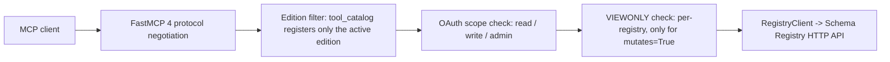
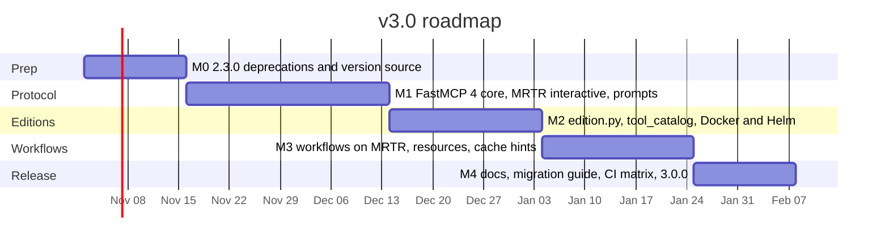

# v3.0 Design and Roadmap

> Status: proposal. Target: `3.0.0`. Baseline: `2.2.2` on branch `chore/fastmcp-3.4-phase1-compat`.
> Companion documents: [CHANGELOG.md](../CHANGELOG.md), [v2 Migration Guide](v2-migration-guide.md).

v3.0 is a major release with two themes:

1. **Latest MCP protocol.** Move from MCP `2025-11-25` on FastMCP 3.x to MCP `2026-07-28` on
   FastMCP 4 / MCP Python SDK 2, while still serving `2025-11-25` clients from the same process.
2. **Two editions.** Split the server into a `developer` edition (read, compatibility checks,
   schema evolution, schema registration) and an `admin` edition (full access: configuration,
   deletion, migration, bulk operations, disaster recovery), selected by one environment variable
   and shipped as two Docker tags from a single codebase.

The release also settles accumulated debt that blocks both themes: scattered version strings,
prompts that are defined but never exposed, resource URIs without handlers, and VIEWONLY
enforcement with gaps.

---

## 1. Goals and non-goals

### Goals

- Speak MCP `2026-07-28` (stateless requests, `server/discover`, multi-round-trip requests,
  tasks extension) and keep every `2025-11-25` client working with no configuration.
- Ship `developer` and `admin` editions with least-privilege defaults. A client connected to a
  developer edition cannot discover, let alone call, a destructive tool.
- One codebase, one Dockerfile, one Helm chart. Editions differ only by a startup setting.
- Make the tool catalog declarative so edition, OAuth scope, VIEWONLY enforcement, and MCP tool
  annotations come from one table instead of ~18 `if not SLIM_MODE:` blocks.
- One version source consumed by code, image labels, and the Helm chart.
- Actually expose the nine prompts in `mcp_prompts.py` and make every `_links` URI resolvable.

### Non-goals

- No new Schema Registry features (for example an automated DR restore/import tool). Those are
  3.1 candidates; see section 5.
- No second repository or second installable package. Editions are a runtime profile.
- No change to the Schema Registry HTTP client layer in `schema_registry_common.py` beyond what
  centralised VIEWONLY enforcement needs.
- No removal of OAuth scopes. Scopes remain the per-user authorization layer inside an edition.

---

## 2. Editions design

### 2.1 Selection

- New module `edition.py` reads `MCP_EDITION` once at import time. Valid values: `developer`,
  `admin`. Unknown values fail fast with a clear error.
- Default when unset: `developer` (least privilege). The startup banner and the `ping` tool
  report the active edition so a misconfigured deployment is obvious.
- `SLIM_MODE=true` becomes a deprecated alias for `MCP_EDITION=developer` (warning on startup,
  removed in 4.0). `SLIM_MODE` with `MCP_EDITION=admin` is an error.
- Docker tags published by [publish.yml](../.github/workflows/publish.yml):
  - `:3.0.0-developer`, `:3.0-developer`, `:3-developer`, `:latest-developer`, `:stable-developer`
  - `:3.0.0-admin`, `:3.0-admin`, `:3-admin`, `:latest-admin`, `:stable-admin`
  - plain `:3.0.0`, `:3.0`, `:3`, `:latest`, `:stable` are aliases of the developer image
  - The edition is baked in via `ENV MCP_EDITION=...` so it works without any extra client
    configuration, and can still be overridden by the environment.
- Helm: new value `edition: developer|admin` in [helm/values.yaml](../helm/values.yaml). It
  selects the image tag suffix and sets `MCP_EDITION` in the ConfigMap. `values-remote-mcp.yaml`
  and `helm/examples/*` get an explicit `edition:` line.
- `config-examples/` gains `claude_desktop_developer_config.json` and
  `claude_desktop_admin_config.json`; the existing `viewonly` example is kept and points at the
  developer edition.

### 2.2 Why "not registered" rather than "registered but blocked"

MCP `2026-07-28` makes `tools/list`, `prompts/list` and `resources/list` cacheable and requires
that they do not vary per connection. A catalog that lists admin tools but rejects them per call
would either break caching or leak the admin surface to developer clients. Therefore:

- Tools, prompts and resources outside the active edition are **never registered** with FastMCP.
- Within an edition, OAuth scopes and VIEWONLY continue to gate individual calls.
- A smaller catalog also saves model context: the developer edition exposes 44 tools instead of
  the 74 registered today.

### 2.3 Declarative tool catalog

New module `tool_catalog.py` holds one entry per tool:

```python
@dataclass(frozen=True)
class ToolSpec:
    name: str
    editions: frozenset[str]        # {"developer", "admin"} or {"admin"}
    scope: str                      # "read" | "write" | "admin"
    mutates: bool                   # subject to VIEWONLY enforcement
    annotations: ToolAnnotations    # readOnlyHint / destructiveHint / idempotentHint
    task: bool = False              # register with task=True (fastmcp-tasks)
```

`kafka_schema_registry_unified_mcp.py` iterates the catalog and registers only the entries whose
`editions` contain the active edition. The same table drives:

- `SCOPE_DEFINITIONS[...]["includes"]` in `oauth_provider.py` (generated, no stale names).
- The centralised VIEWONLY check (section 2.5).
- `get_mcp_compliance_status_tool` and `list_available_resources` output.
- `tests/test_editions.py`, which snapshots the exact catalog per edition.

### 2.4 Catalog by edition

Names below are the registered MCP tool names as of `2.2.2`.

**Developer edition** (also included in admin)

| Group | Tools |
|---|---|
| Protocol and discovery | `ping`, `get_mcp_compliance_status_tool`, `list_available_resources`, `suggest_resource_for_tool`, `generate_resource_templates`, `get_oauth_scopes_info_tool`, `test_oauth_discovery_endpoints` |
| Registry info | `list_registries`, `get_registry_info`, `test_registry_connection`, `test_all_registries`, `get_default_registry` |
| Read | `list_subjects`, `list_contexts`, `get_schema`, `get_schema_versions`, `get_schema_by_id`, `get_subjects_by_schema_id`, `get_global_config`, `get_mode`, `get_subject_config`, `get_subject_mode` |
| Compatibility and evolution | `check_compatibility`, `check_compatibility_interactive`, `guided_schema_evolution` |
| Registration | `register_schema`, `register_schema_interactive` |
| Export | `export_schema`, `export_subject`, `export_context`, `export_global`, `export_global_interactive` |
| Comparison | `compare_registries`, `compare_contexts_across_registries`, `find_missing_schemas` |
| Statistics | `count_contexts`, `count_schemas`, `count_schema_versions`, `get_registry_statistics` |
| Workflow inspection | `list_workflows`, `workflow_status`, `describe_workflow`, `list_available_workflows`, `get_workflow_status` |

Developer prompts: `schema-getting-started`, `schema-registration`, `schema-compatibility`,
`schema-evolution`, `schema-export`, `troubleshooting`.

Developer resources: all `registry://`, `schema://` and `subject://` read resources.

**Admin edition** (developer set plus the following)

| Group | Tools |
|---|---|
| Context and subject lifecycle | `create_context`, `create_context_interactive`, `delete_context`, `delete_subject` |
| Configuration and mode | `update_global_config`, `update_subject_config`, `update_mode`, `update_subject_mode`, `add_subject_alias`, `delete_subject_alias`, `set_default_registry` |
| Migration | `migrate_schema`, `migrate_context`, `migrate_context_interactive`, `migrate_schema_interactive` (new registration; function already exists in `interactive_tools.py`) |
| Batch and bulk | `clear_context_batch`, `clear_multiple_contexts_batch`, `bulk_operations_wizard`, `bulk_schema_update`, `bulk_schema_cleanup`, `bulk_schema_migration`, `bulk_configuration_update`, plus `preview_bulk_operation`, `get_bulk_operation_status`, `cancel_bulk_operation` (declared in `bulk_operations_mcp_integration.py` but never registered today) |
| Guided workflows | `start_workflow`, `abort_workflow`, `guided_schema_migration`, `guided_context_reorganization`, `guided_disaster_recovery` |

Admin prompts: all nine (adds `context-management`, `multi-registry`, `advanced-workflows`).

Removed in 3.0 (both editions): `submit_elicitation_response`, `list_elicitation_requests`,
`get_elicitation_request`, `get_elicitation_status`, `cancel_elicitation_request` and the
`elicitation://response/{request_id}` resource. These exist only to drive the home-grown
elicitation fallback, which multi-round-trip requests replace (section 3.3).

Boundary decisions worth stating explicitly:

- `register_schema` is in developer because schema evolution ends with registering the next
  version. It is a `write`-scope, non-destructive, VIEWONLY-gated operation.
- `create_context` is admin. Contexts are a tenancy/organisation boundary, not part of a
  developer's day-to-day evolution loop.
- `check_compatibility` and all `export_*` stay `read` scope.
- `delete_subject_alias` moves from `write` to `admin` scope to match `add_subject_alias` being
  admin-edition only.

### 2.5 Relationship to VIEWONLY and OAuth scopes

The three mechanisms are orthogonal and layered:



- **Edition** decides what the server exposes. Set by the operator per deployment.
- **OAuth scope** decides what a given user may call inside the edition. Developer edition
  never requires the `admin` scope. Scope checks move from the custom `require_scopes`
  decorator (which lacks `functools.wraps` and reimplements token validation) to FastMCP 4's
  native scope checks, so clients receive insufficient-scope challenges naming the missing scope.
- **VIEWONLY** decides what a given registry accepts. It stays per registry and is enforced in
  one place: a FastMCP middleware (or decorator applied during catalog registration) that reads
  `ToolSpec.mutates` and the `registry` argument, replacing the ten hand-written
  `check_viewonly_mode(...)` calls in `core_registry_tools.py` and closing the gaps in
  `migration_tools.py`, `bulk_operations_wizard.py`, `interactive_tools.py` and
  `workflow_mcp_integration.py`. `READONLY`, `READONLY_{n}`, the `readonly` JSON key,
  `is_readonly()` and `check_readonly_mode()` (all deprecated since 2.x) are removed.

---

## 3. Protocol upgrade design (MCP 2026-07-28 on FastMCP 4)

### 3.1 What changed upstream

MCP `2026-07-28` (stable 2026-07-28) relative to `2025-11-25`:

- No `initialize` handshake and no `Mcp-Session-Id`; each request carries protocol version,
  client info and capabilities in `_meta`. Servers must implement `server/discover`.
- `tools/list`, `prompts/list`, `resources/list` are cacheable and must not vary per connection.
- Server-initiated requests (`elicitation/create`, `sampling/createMessage`, `roots/list`) are
  gone. Interactivity uses multi-round-trip requests (MRTR): a tool returns
  `resultType: "input_required"` and the client retries with `inputResponses`.
- Protocol `ping`, `logging/setLevel` and SSE resumability are removed. Log level is per request.
- Tasks move to the `io.modelcontextprotocol/tasks` extension (`tasks/get` polling).
- `Mcp-Method` / `Mcp-Name` routing headers for gateways; server cache hints; argument
  completion for prompt and resource-template inputs.

FastMCP 4.0.0 (GA 2026-08-31) on MCP Python SDK 2.0 serves both eras from one deployment and
negotiates per connection. Relevant breaking changes for this repository: `ctx.elicit()` is
legacy-protocol only, background tasks live in the separate `fastmcp-tasks` package, FastMCP 3
deprecated APIs are removed, MCP model fields are snake_case, and the stack moves to httpx 2.

### 3.2 Dependency pins

- `fastmcp>=4.0,<5`, `fastmcp-tasks` (replaces the `fastmcp[tasks]` extra), `mcp>=2.0,<3`.
- Verify httpx 2 against our own `httpx` usage and against `requests`/`aiohttp` coexistence;
  consolidate on `httpx.AsyncClient` where the migration touches a module anyway.
- Python floor stays `>=3.10` unless FastMCP 4 or SDK 2 require 3.11; record the outcome in
  `pyproject.toml` and the Dockerfile (currently `python:3.14-slim-bookworm`).
- `scripts/check-deps-parity.py` keeps `requirements.txt` aligned.

### 3.3 Server changes

- **Remove the custom protocol middleware.** `MCP_PROTOCOL_VERSION`, `SUPPORTED_MCP_VERSIONS`,
  `validate_mcp_protocol_version_middleware` and `EXEMPT_PATHS` in
  `kafka_schema_registry_unified_mcp.py` go away; the SDK owns version negotiation and
  `server/discover`. Tool responses report the negotiated version from the SDK instead of a
  hard-coded literal (`core_registry_tools.py`, `comparison_tools.py`, `statistics_tools.py`
  currently embed `"2025-11-25"`).
- **Keep the application-level `ping` tool.** It is an ordinary tool, not the removed protocol
  method. Its payload drops the stale `server_version` string and reports edition, package
  version, negotiated protocol version and registry mode.
- **Interactive tools on MRTR.** `register_schema_interactive`, `check_compatibility_interactive`,
  `create_context_interactive`, `export_global_interactive`, `migrate_context_interactive`,
  `migrate_schema_interactive` and `bulk_operations_wizard` move from `ctx.elicit()` to FastMCP 4
  multi-round-trip tools (`Resolve(...)` dependencies / `input_required` results). One tool body
  serves both eras: legacy clients still see `elicitation/create`, modern clients see MRTR.
- **Multi-step workflows on MRTR.** `multi_step_elicitation.py` and
  `workflow_mcp_integration.py` keep workflow state in the sealed `request_state` that the SDK
  carries across round trips instead of the in-process `active_workflows` dictionary, so any
  replica can continue a workflow. Helm gets a `requestStateKeys` secret feeding
  `RequestStateSecurity(keys=[...])` for multi-replica deployments. `smart_defaults*.py`
  pre-population plugs into the first round trip.
- **Remove the home-grown elicitation fallback.** `elicitation.py` mock mode,
  `elicitation_mcp_integration.py` request registry, the five `*_elicitation_*` tools and the
  `elicitation://response/{request_id}` resource are deleted. Clients without MRTR or
  elicitation support get a structured error naming the non-interactive tool to use instead.
- **Tasks.** `migrate_schema`, `migrate_context`, `clear_context_batch`,
  `clear_multiple_contexts_batch`, `count_schemas`, `get_registry_statistics` keep `task=True`
  via `fastmcp-tasks`. Verify `tasks/get` polling, unsolicited task handles, and encrypted task
  snapshots; drop any code relying on `tasks/list` or blocking `tasks/result`.
- **Prompts.** Register the nine generators in `mcp_prompts.PROMPT_REGISTRY` with
  `@mcp.prompt`, filtered by edition. Add argument completion for prompt arguments and for the
  `{name}`, `{context}` and `{subject}` placeholders in resource templates (completions come
  from `list_registries`, `list_contexts`, `list_subjects`).
- **Resources.** Unify `resource_linking.py` URIs (`registry://{name}/contexts/{ctx}/subjects/...`,
  `.../migrations/{id}`, `.../tasks/{id}`) with the registered `@mcp.resource` handlers so every
  emitted `_links` entry resolves. Add server cache hints (short TTL) on list/read resources.
- **Gateway routing.** Document `Mcp-Method` / `Mcp-Name` headers in
  [remote-mcp-deployment.md](remote-mcp-deployment.md) and add an ingress example that routes
  admin-only tool names to the admin deployment. Keep the `/health`, `/ready`, `/metrics` and
  `/.well-known/*` custom routes in `remote-mcp-server.py`.
- **Logging.** Honour the per-request log level from `_meta`; stop emitting
  `notifications/message` for requests that did not ask for it.
- **Deferred.** Identity assertion (SEP-990, beta in FastMCP 4) and client-credentials auth are
  3.1 candidates once the OAuth provider tests exist for them.

---

## 4. Housekeeping bundled into 3.0

- **Single version source.** Add `_version.py` (or read `importlib.metadata.version(...)`) and
  consume it from `ping`, `get_mcp_compliance_status_tool`, the resource handlers,
  `remote-mcp-server.py` (`mcp_server_version`), the Dockerfile `VERSION` build arg and
  `scripts/publish-helm-chart.sh`. Bump `helm/Chart.yaml` (frozen at 1.8.0) to `3.0.0` /
  `appVersion: "3.0.0"` and fix `helm/values.yaml` `tag`.
- **Packaging.** Extend `[tool.hatch.build] include` in `pyproject.toml` and the explicit `COPY`
  lines in the Dockerfile to cover every module (elicitation, workflows, smart defaults, bulk
  operations, resource linking, schema validation/definitions, registry management, interactive
  tools, `remote-mcp-server.py`, plus the new `edition.py` and `tool_catalog.py`). Prefer a
  package directory or a glob so the list cannot drift again.
- **Stale text.** Remove remaining "MCP 2025-06-18" wording in `oauth_provider.py`,
  `elicitation.py`, `schema_definitions.py`, the main file banner, `QUICK_REFERENCE.md`,
  `GETTING_STARTED.md` and `docs/`.
- **Release process.** Rewrite `.github/RELEASE_PROCESS.md` (still describes 1.3.0) around
  the tag-driven publish workflow and the edition tag matrix.

---

## 5. Milestones and roadmap

Durations are relative and sequential; the branch base is `chore/fastmcp-3.4-phase1-compat`.



### M0 - Prep, ships as `2.3.0` (2 weeks)

- Deprecation warnings at startup for `READONLY*`, `SLIM_MODE`, and the five
  `*_elicitation_*` tools; announce editions in README and CHANGELOG `[Unreleased]`.
- Single version source and Helm chart version bump (section 4) land here so 2.3.0 already
  reports a correct version everywhere.
- Open `release/3.0` branch and a tracking issue listing M1-M4 with checkboxes.
- Exit: `2.3.0` tagged, warnings visible, no behaviour change.

### M1 - Protocol core, ships as `3.0.0-alpha.1` (4 weeks)

- FastMCP 4 / SDK 2 / `fastmcp-tasks` pins; fix import and snake_case breakages.
- Delete the protocol middleware; verify `server/discover` and legacy `initialize` both work.
- Port the seven `*_interactive` tools and `bulk_operations_wizard` to MRTR
  (`guided_schema_evolution` is the first multi-step workflow ported, as the developer pilot).
- Register prompts with `@mcp.prompt`.
- MCP conformance suite green for both protocol eras; `tests/test_fastmcp3_compat.py` replaced
  by `tests/test_fastmcp4_compat.py`.
- Exit: alpha image published, all `tests/run_all_tests.sh --quick` categories pass.

### M2 - Editions, ships as `3.0.0-beta.1` (3 weeks)

- `edition.py`, `tool_catalog.py`, catalog-driven registration; remove `if not SLIM_MODE` blocks.
- Centralised VIEWONLY enforcement; remove `READONLY*`.
- Native FastMCP scope checks; regenerate `SCOPE_DEFINITIONS` from the catalog.
- Register `migrate_schema_interactive` and the three bulk status/cancel/preview tools.
- Docker tag matrix in `publish.yml`, `ENV MCP_EDITION` build arg, Helm `edition` value, edition
  config examples.
- Exit: `tests/test_editions.py` snapshots match section 2.4; CI runs the full suite for both
  editions.

### M3 - Workflows and resources, ships as `3.0.0-rc.1` (3 weeks)

- Remaining guided workflows (`guided_schema_migration`, `guided_context_reorganization`,
  `guided_disaster_recovery`) on MRTR with `request_state`; `RequestStateSecurity` wiring in Helm.
- Remove the elicitation fallback tools and resource.
- Resource URI unification, cache hints, argument completion.
- Gateway routing header documentation and ingress example.
- Exit: `inspector-tests/` pass against both editions in both protocol modes.

### M4 - Release, ships as `3.0.0` (2 weeks)

- `docs/v3-migration-guide.md`, README, `docs/README.md`, `docs/api-reference.md`,
  `docs/mcp-tools-reference.md` updated with per-edition tool tables.
- CHANGELOG `[3.0.0]` with a Breaking Changes section.
- Security scans (`security-scan.yml`, `docker-security-scan.yml`) on both images;
  `.trivyignore` review.
- Helm chart `3.0.0` published; `tag-stable.yml` moves `stable` and `stable-admin`.
- Exit: tag `v3.0.0`, images and chart published, migration guide linked from README.

### Post-3.0 candidates (3.1)

- Automated DR restore/import tool to complement `export_*` and `guided_disaster_recovery`.
- Identity assertion (SEP-990) and machine-to-machine client auth in `oauth_provider.py`.
- `ClientGroup`-based multi-registry proxying for very large registry fleets.
- Positive cache hints tuned per resource once client support is widespread.

---

## 6. Implementation plan

### 6.1 Files touched per milestone

**M0**

- `_version.py` (new), `pyproject.toml`, `kafka_schema_registry_unified_mcp.py` (`ping`,
  compliance tool, resource handlers, banner), `remote-mcp-server.py`,
  `schema_registry_common.py` (deprecation warnings), `helm/Chart.yaml`, `helm/values.yaml`,
  `helm/README.md`, `scripts/publish-helm-chart.sh`, `CHANGELOG.md`, `README.md`.

**M1**

- `pyproject.toml`, `requirements.txt`, `Dockerfile`, `kafka_schema_registry_unified_mcp.py`
  (middleware removal, `@mcp.prompt` registration), `interactive_tools.py`,
  `bulk_operations_wizard.py`, `elicitation.py`, `elicitation_mcp_integration.py`,
  `multi_step_elicitation.py` (evolution workflow only), `workflow_mcp_integration.py`,
  `core_registry_tools.py` / `comparison_tools.py` / `statistics_tools.py` (protocol version
  literal), `mcp_prompts.py`, `tests/test_fastmcp4_compat.py` (new), `tests/test_mcp_compliance.py`,
  `tests/test_mcp_header_validation.py` (delete), `tests/test_elicitation*.py`,
  `tests/test_prompts.py`.

**M2**

- `edition.py` (new), `tool_catalog.py` (new), `kafka_schema_registry_unified_mcp.py`
  (catalog-driven registration), `oauth_provider.py` (`SCOPE_DEFINITIONS` from catalog, native
  scope checks, remove custom `require_scopes`), `schema_registry_common.py` (remove
  `READONLY*`, keep `is_viewonly`), `core_registry_tools.py` (drop inline VIEWONLY calls),
  `batch_operations.py`, `migration_tools.py`, `bulk_operations_mcp_integration.py`,
  `Dockerfile` (`ARG MCP_EDITION`), `.github/workflows/publish.yml`,
  `.github/workflows/tag-stable.yml`, `helm/values.yaml`, `helm/values-remote-mcp.yaml`,
  `helm/templates/configmap.yaml`, `helm/templates/deployment.yaml`, `helm/examples/*.yaml`,
  `config-examples/claude_desktop_developer_config.json` (new),
  `config-examples/claude_desktop_admin_config.json` (new), `config-examples/README.md`,
  `tests/test_editions.py` (new), `tests/test_viewonly_*.py`, `tests/test_slim_mode_integration.py`
  (rewritten as alias test), `tests/run_all_tests.sh` (`--edition` flag),
  `.github/workflows/test.yml` (matrix).

**M3**

- `multi_step_elicitation.py`, `workflow_definitions.py`, `workflow_mcp_integration.py`,
  `smart_defaults*.py`, `resource_linking.py`, `kafka_schema_registry_unified_mcp.py`
  (resource handlers, cache hints, completions), `remote-mcp-server.py`
  (`RequestStateSecurity`), `helm/templates/secret.yaml`, `helm/templates/ingress.yaml`,
  `docs/remote-mcp-deployment.md`, `inspector-tests/`, `tests/test_resource_linking.py`,
  `tests/test_multi_step_elicitation.py`, `tests/test_end_to_end_workflows.py`.

**M4**

- `docs/v3-migration-guide.md` (new), `docs/README.md`, `docs/api-reference.md`,
  `docs/mcp-tools-reference.md`, `docs/deployment.md`, `README.md`, `dockerhub-readme.md`,
  `QUICK_REFERENCE.md`, `GETTING_STARTED.md`, `CHANGELOG.md`, `.github/RELEASE_PROCESS.md`,
  `SECURITY.md`.

### 6.2 Testing strategy

- `tests/test_editions.py`: imports the server with `MCP_EDITION` set to each value and asserts
  the exact sorted list of tool, prompt and resource names against a committed snapshot
  (section 2.4). Any catalog change must update the snapshot deliberately.
- CI matrix in `.github/workflows/test.yml`: `edition: [developer, admin]` for `test-quick`,
  `test-full` and `test-mcp-container`. The `docker-build` job builds both tag variants.
- Compliance tests connect twice: `fastmcp.Client(target)` (negotiates `2026-07-28`) and
  `fastmcp.Client(target, mode="legacy")` (forces `2025-11-25`), and assert identical catalogs
  and identical tool results.
- A new `conformance.yml` job runs the official MCP conformance suite against the HTTP
  transport of the admin image.
- `tests/run_all_tests.sh` gains `--edition developer|admin|both` (default `both`); the
  per-edition results land in `tests/results/<edition>/`.
- Interactive and workflow tests drive MRTR through the FastMCP client's `elicitation_handler`
  so the same test exercises both eras.
- VIEWONLY tests gain cases for every `mutates=True` tool, generated from the catalog, so the
  centralised check cannot regress silently.

### 6.3 Risk register

| Risk | Likelihood | Impact | Mitigation |
|---|---|---|---|
| httpx 2 breaks `requests`/`aiohttp` interplay or SSL options | Medium | Medium | Spike in M1 week 1; consolidate on `httpx.AsyncClient`; pin and test SSL/TLS integration early |
| Clients (Claude Desktop, Cursor) lag on MRTR support | High | Low | FastMCP 4 dual-era negotiation keeps legacy `elicitation/create` working; structured error for clients with neither |
| Workflow state too large for sealed `request_state` | Medium | Medium | Store only step cursor and answers; keep registry snapshots server-side keyed by task id |
| Users on `:latest` lose admin tools after upgrade | High | Medium | Migration guide first, startup banner naming the edition, `:stable-admin` / `:latest-admin` tags, deprecation notice in 2.3.0 |
| `fastmcp-tasks` behaviour differs from 3.x tasks | Medium | Medium | Port one task tool first (`count_schemas`), extend `tests/test_statistics_tasks.py` before touching migration |
| Removing the elicitation fallback breaks `mock` test paths | Medium | Low | Replace with FastMCP in-memory client tests; delete mock-only tests |
| Scope change for `delete_subject_alias` surprises existing tokens | Low | Low | Call out in Breaking Changes; `admin` already includes `write` |

### 6.4 Backward compatibility matrix

| Area | 2.x behaviour | 3.0 behaviour |
|---|---|---|
| MCP protocol | `2025-11-25` only, custom header middleware | `2026-07-28` negotiated, `2025-11-25` still served |
| Default tool set | All 74 tools unless `SLIM_MODE` | Developer edition (44 tools); set `MCP_EDITION=admin` or use `-admin` tag for full set |
| `SLIM_MODE=true` | Reduces to ~20 tools | Deprecated alias for `MCP_EDITION=developer`, warning |
| `VIEWONLY` / `VIEWONLY_{n}` / `viewonly` | Supported | Supported, enforced centrally |
| `READONLY*` / `readonly` | Deprecated with warning | Removed (startup error with hint) |
| OAuth scopes `read`/`write`/`admin` | Custom `require_scopes` | Native FastMCP checks with step-up challenges; same scope names |
| `delete_subject_alias` scope | `write` | `admin` |
| Interactive `*_interactive` tools | `ctx.elicit()` with mock fallback | MRTR on modern clients, elicitation on legacy clients, no mock |
| `*_elicitation_*` tools, `elicitation://response/{id}` | Present | Removed |
| Background tasks | FastMCP 3 tasks | `fastmcp-tasks` extension, `tasks/get` polling |
| Prompts | Defined, not exposed | Nine prompts exposed via `prompts/list`, filtered by edition |
| `_links` URIs | Some not resolvable | All resolvable |
| Docker tags | `:x.y.z`, `:latest`, `:stable` | Same tags = developer; add `-developer` / `-admin` suffixed tags |
| Helm | `image.tag` only | `edition` value selects tag and env |
| Single/multi registry auto-detection | Unchanged | Unchanged |
| Python | 3.10+ | 3.10+ (3.11+ if forced by FastMCP 4; recorded in M1) |

---

## 7. Open questions

Each question records the proposed default so work can proceed without blocking.

1. **Default edition for plain `:latest` / `:stable` tags.** Proposed: `developer`. Least
   privilege by default; admins opt in explicitly. Alternative: keep plain tags as admin for
   2.x continuity and accept the larger blast radius.
2. **Does `create_context` belong to developer?** Proposed: admin. Context creation is a
   tenancy decision. Revisit if developer-edition users regularly need scratch contexts.
3. **Lifetime of the `SLIM_MODE` alias.** Proposed: deprecated alias through 3.x, removed in
   4.0. Alternative: remove at 3.0 since it is a major release anyway.
4. **Order of porting multi-step workflows to MRTR.** Proposed: `guided_schema_evolution` in
   M1 as the developer-edition pilot, the remaining three in M3. Alternative: port all four
   together in M3 and ship M1 with the legacy elicitation path for workflows.
5. **Scope for `register_schema` in developer edition.** Proposed: keep `write`. Alternative:
   introduce a `register` scope so a token can register without touching configuration; this
   would be additive and could land in 3.1.
