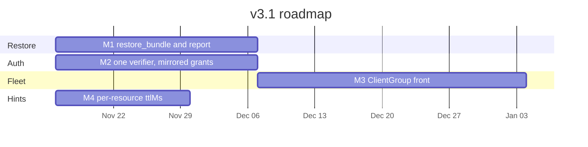

# v3.1 Design and Roadmap

> Status: design. Not implemented. Baseline: `3.0.0` on `main`.
> Companion: [v3.0 design](v3-roadmap.md), which deferred the four items below.

v3.1 adds the behaviour v3.0 left on the far side of a thin interface. Four modules,
one minor release. Editions, the task backend, and the Schema Registry HTTP client
stay as they are.

1. **Restore.** Read an export document back into a registry.
2. **Identity and machine clients.** One resource-server validator for human access
   tokens, client-credentials tokens, and tokens minted after a SEP-990 ID-JAG exchange.
3. **Fleet.** A front process that routes `registry=` to a shard through FastMCP
   `ClientGroup`, for fleets that do not fit in eight environment variables.
4. **Cache hints.** A per-resource SEP-2549 table, including a schema-by-id resource
   that can carry a long TTL.

## 1. Goals and non-goals

### Goals

- An admin task that applies an `export_global`, `export_context`, or `export_subject`
  document to one named registry, dry-run unless told to write, preserving schema ids.
- `guided_disaster_recovery` names that task. The planner does not write.
- Accept client-credentials access tokens and SEP-990 access tokens with the same
  verifier that already accepts authorization-code tokens.
- Advertise `client_credentials` and `urn:ietf:params:oauth:grant-type:jwt-bearer`
  only when the upstream authorization server lists them.
- Serve hundreds of registries from a front process that holds no registry passwords.
  The model-facing catalog stays the edition catalog. Tools keep `registry=`.
- Emit a positive `ttlMs` where the data allows it, and `0` where a cached copy
  would be wrong. Clients that ignore hints behave as they do today.

### Non-goals

- No second bundle format. `export_version` stays whatever the exporter already writes.
- No authorization server in this process, and no ID-JAG exchange. SEP-990's client
  adapter (`IdentityAssertionOAuthProvider`) stays on the MCP client.
- No per-registry tool catalog. `ClientGroup`'s `{member}_{tool}` prefix stays inside
  the shard adapter.
- No mixed process that holds some registry passwords and proxies the rest.
- `migrate_schema` stays the live-to-live copy of one subject. Restore's source is
  the document.
- No change to lint configuration, the three editions, or `TasksExtension`.
- No cache-store inside the server. The client caches. The server emits hints.
- No grant-class type on the caller-facing principal, and no per-IdP branch.

## 2. Restore

### 2.1 Interface

```python
async def restore(
    bundle: Mapping[str, Any],
    target: str,
    fleet: Fleet,
    *,
    apply: bool = False,
    accept_new_ids: bool = False,
    context: str | None = None,
    subject: str | None = None,
) -> RestoreReport:
    ...
```

`RestoreReport.status` is `dry_run`, `applied`, `incomplete`, `confirmation_required`,
or `rejected`. The report also carries `created`, `skipped`, `conflicts`, and
`id_preservation` (`preserved`, `import_required`, or `new_ids`).

The MCP tool is `restore_bundle`. Admin edition, scope `admin`, destructive,
`task=True`. It passes the process's `Fleet` in. Tests pass a recording fleet and
open no socket.

`apply` defaults to false, so the common call previews. `accept_new_ids` is the
retry after `confirmation_required`. Schema-id preservation is the behaviour of
every other call. The operator does not pass an IMPORT-mode flag.

`context` and `subject` narrow the document. `subject` requires `context`. Both
default to the whole bundle.

### 2.2 Document contract

A bundle is a dict in one of three shapes:

| Source | Shape |
|---|---|
| `export_global` | `contexts`, `default_context`, optional `global_config` / `global_mode` |
| `export_context` | `context`, `subjects`, optional `global_config` / `global_mode` |
| `export_subject` | `subject`, `versions`, optional `config` |

Top-level `metadata.export_version` is accepted when it is the literal `"1.7.0"`
(`schema_registry_common`) or the server version the MCP tools stamp today
(`export_context` and `export_global` in `export_tools.py` write `__version__`).
Those stamps are the same document. A future shape change is what bumps the version.
Until then, restore does not reject a backup because the stamp says `3.0.0`.

Rejected before any HTTP, with `status=rejected`:

- a string (Avro IDL)
- a dict whose only useful key is `error`
- a bare `export_schema` object, which has no subject history
- a missing `export_version`

### 2.3 Write order and schema ids

Order is fixed: contexts, then subjects with a referenced subject first, then
versions ascending, then compatibility config, then mode.

`apply=False` writes nothing and does not change mode. It still reports whether
IMPORT mode would be required.

`apply=True` dispatches a mode change to `IMPORT` for the version writes, then
dispatches the previous mode again, including when a later step fails
(`incomplete`). A retry of the same bundle skips a version whose schema id and
body already match, and reports a conflict when that id exists with a different
body. The conflict is not overwritten.

If IMPORT mode cannot be set, nothing is written and the status is
`confirmation_required`. The retry is the same call with `accept_new_ids=True`,
which registers new schema ids and lists them on the report.

The shard's `register_schema` path accepts optional `schema_id` and `version`.
That is how IMPORT mode preserves an id. Callers that omit them keep today's
behaviour.

VIEWONLY stays in `GuardedSession` on the process that holds the registry.
Restore grows no allowlist. A write against a VIEWONLY registry comes back
`rejected`.

### 2.4 Who calls it

`guided_disaster_recovery` stays the planner for backup target and schedule. Its
verify step names `restore_bundle` and does not call it. One tool writes. This
matches `guided_schema_evolution`, which returns a plan and leaves registration
to `register_schema`.

`migrate_schema` is not a caller and not the implementation. It needs a live
source registry. Restore needs a document.

### 2.5 What stays inside

Context creation, reference order, the IMPORT window, mode restore on failure,
and skip-if-equal. Callers see the report.

The task backend is the existing `TasksExtension`. Restore does not grow a task port.

## 3. Identity and machine clients

This process stays a resource server. `AUTH_ISSUER_URL` stays an external
authorization server. An enterprise client exchanges an ID-JAG at that server
(SEP-990, RFC 7523 `urn:ietf:params:oauth:grant-type:jwt-bearer`) and presents
the access token here. This module never sees the ID-JAG.

### 3.1 Interface

```python
@dataclass(frozen=True)
class Principal:
    scopes: frozenset[str]    # read / write / admin, already expanded
    subject: str | None
    client_id: str | None

async def authenticate(token: str, *, resource: str | None = None) -> Principal: ...

async def advertised_grants() -> tuple[str, ...]: ...
```

`authenticate` checks signature, `iss`, `exp`, and audience. At least one of
`sub`, `client_id`, or `azp` is present. `sub` alone is not required, so a
client-credentials token whose subject is the client id passes. Scopes stay
`read` / `write` / `admin`. `require_scopes` stays the tool gate. Edition stays
a separate gate. A token with scope `admin` does not raise a viewer process to
admin.

PKCE is not read off the access token. `validate_pkce_requirements` already
returns true for every token, because the proof was checked at issuance.
`authenticate` does not grow a second copy of that check.

`advertised_grants` is the intersection of upstream `grant_types_supported` with
`authorization_code`, `client_credentials`, and
`urn:ietf:params:oauth:grant-type:jwt-bearer`. A grant the issuer does not list
is not added. When that intersection contains the jwt-bearer URN, the
protected-resource metadata advertises the enterprise-managed authorization
extension. That is this server's piece of SEP-990.

### 3.2 One verifier

Today two validators run. FastMCP's `JWTVerifier` accepts the bearer token, then
`require_scopes` calls `validate_token_comprehensive`, which requires `sub` and
builds the key with `RSAAlgorithm.from_jwk`. v3.1 deletes the second parse.
`OAuth21BearerAuthProvider` is the only verifier. Algorithms follow the issuer's
JWKS, including EdDSA when the issuer publishes it.

Grant class is a table inside that verifier. It is not a type on `Principal`
and not a port.

| `gty` | Identity required | PKCE |
|---|---|---|
| `authorization_code` | `sub` | Issuance rule. Discovery must advertise `S256`. The token is not rejected for lacking a verifier claim. |
| `client_credentials` | any one of `sub`, `azp`, `client_id` | Does not apply. |
| `urn:ietf:params:oauth:grant-type:jwt-bearer` | `sub` (the subject the authorization server put on the access token) | Does not apply. |
| absent | any one of `sub`, `azp`, `client_id` | Does not apply. |

Issuers omit `gty`. The absent row is what keeps a valid machine token from
failing closed. Requiring `gty` on every token would reject tokens real
authorization servers already issue.

### 3.3 Issuer port

Discovery and JWKS are one port, injected when the verifier is built. Callers of
`authenticate` do not see it.

- `HttpAuthorizationServer` fetches `AUTH_ISSUER_URL` and the JWKS URI. Production.
- `FakeAuthorizationServer` returns canned metadata and a local JWKS. Tests.

A quiet upstream fails closed. No synthesized grant list, except the existing
GitHub document, which has no discovery endpoint and is not a pattern for
another provider.

## 4. Fleet

`MultiRegistryManager` loads at most eight registries from
`SCHEMA_REGISTRY_NAME_N` / `SCHEMA_REGISTRY_URL_N`. A fleet of hundreds cannot
be eight environment variables and one credential set. FastMCP `ClientGroup`
holds one MCP client per shard. Each client negotiates its own protocol era.

### 4.1 One role per process

Startup selects one adapter.

| Role | Adapter | Credentials |
|---|---|---|
| This process owns the registries (today, one to eight) | `InProcessFleet` wrapping `MultiRegistryManager` | In this process |
| This process is the front | `ClientGroupFleet` | None. Shard URLs and the directory only. |
| Tests | `RecordingFleet` | None. Stores `(tool, arguments)`. |

A name is never both local and remote. A front does not load
`SCHEMA_REGISTRY_USER` or `SCHEMA_REGISTRY_PASSWORD` for a registry a shard owns.
`VIEWONLY` is enforced on the process that owns the registry.

The directory is `registry name → shard member`. It is environment configuration,
identical on every replica. A process-local `ClientGroup` may pool connections.
The directory, not the pool, decides the next request, so any replica can serve it.

### 4.2 Interface

```python
class Fleet:
    async def dispatch(self, tool: str, arguments: Mapping[str, Any]) -> Any: ...
    def names(self) -> list[str]: ...
```

`InProcessFleet.dispatch` runs the tool body already registered in this process.
`ClientGroupFleet.dispatch` calls `{member}_{tool}` and strips the prefix before
returning. The model sees one catalog. `{shard}_list_subjects` is not registered
on the front.

Routing:

- A tool whose registry names all sit on one shard runs there, as that tool,
  with the same arguments. Single-registry tool bodies stay on the shard.
  The front does not reimplement them.
- `list_registries` returns `names()`. It does not fan out.
- `compare_registries`, `find_missing_schemas`, and `migrate_schema` name two
  registries. On a front they run in this process and call `dispatch` once per
  registry. A cross-shard migrate is `export_subject` on the source shard and
  `restore` on the target shard.
- The caller's bearer token is forwarded. Shards trust the same
  `AUTH_ISSUER_URL`. The front does not mint a token.
- An unknown registry fails the way `get_registry` fails today, before a call
  leaves the process.

### 4.3 Why dispatch, and not a method per registry call

A port with one method per Schema Registry operation (`list_subjects`,
`register_schema`, `update_mode`, and the rest) looks precise and forces every
tool onto it. Those operations already exist as tools on the shard. Re-declaring
them, then implementing them twice, duplicates the catalog editions just
collapsed. `get_registry() -> RegistryClient` is smaller and cannot be
implemented for a shard: the front would be holding an HTTP client whose
password lives elsewhere, and `migration_tools.py` already uses
`target_client.session.put` on that client.

`dispatch` is the operation the front actually performs: send this tool, with
this `registry`, to the member that owns it.

Tools on an in-process deployment keep calling `RegistryClient` inside
`InProcessFleet`. They are not rewritten to a 25-method protocol.

## 5. Cache hints

One in-process table. `get_fastmcp_config` and resource registration both read
it. Tests read it directly. No port, no decorator, no operator override. A
second place for the same number will drift.

SEP-2549 fields are `ttlMs` (milliseconds, `>= 0`) and `cacheScope` (`public` or
`private`). `0` means the client should treat the result as stale. A positive
value means fresh for that many milliseconds. A per-resource hint overrides the
method default. `private` means the same authorization context only.

| Target | ttlMs | cacheScope |
|---|---|---|
| `tools/list`, `prompts/list`, `resources/list`, `resources/templates/list`, `server/discover` | 60000 | `public` when auth is off, `private` when auth is on |
| `schema://{name}/ids/{schema_id}` | 86400000 | `private` |
| `schema://…/{subject}` and the context form (latest) | 15000 | `private` |
| `subject://…/config`, `subject://…/mode`, `registry://…/config`, `registry://mode/…` | 15000 | `private` |
| version lists and the other collection resources | 60000 | `private` |
| `registry://{name}/tasks`, `registry://{name}/migrations` | 0 | `private` |
| any other `resources/read` | 0 | `private` |

`schema://{name}/ids/{schema_id}` is new, viewer edition, scope `read`.
Schema-by-id is immutable, and today it is only the `get_schema_by_id` tool.
`tools/call` is not a SEP-2549 method, so a long TTL on that tool result would
be a hint clients are not required to honour. The resource is where the 24-hour
hint lives.

Latest, mode, and config stay at 15 seconds because they change during a
conversation and a single turn should be able to reuse a read. Tasks and
migrations are stale on arrival. Schema bodies stay `private` even with auth
off, because they sit behind registry credentials. List results stay `private`
whenever scopes can change what a caller sees, and `public` only when auth is
off and the edition catalog is the same for every caller of that process.

The list default in `get_fastmcp_config` (`cache_ttl=60`, `cache_scope=private`)
becomes the list row above. Sixty seconds is `ttlMs` 60000 on the wire.

## 6. Milestones

M1 and M2 are independent. M3 follows M1, because cross-shard migrate uses
restore. M4 can land any time after the schema-by-id resource exists, which is
part of M4 itself and does not block M1.



### M1 — Restore, ships as `3.1.0-alpha.1`

- `restore` and `restore_bundle` in the admin catalog.
- `guided_disaster_recovery` names `restore_bundle` in its verify step and does
  not call it.
- `register_schema` accepts optional `schema_id` and `version` so a later shard
  can preserve ids. In-process restore uses that path.
- Exit: recording-fleet tests cover dry-run, IMPORT confirmation, skip-present,
  conflict, VIEWONLY, an Avro IDL string, an error dict, and both export-version
  stamps.

### M2 — Identity, ships as `3.1.0-beta.1`

- Delete `validate_token_comprehensive` as a second parse. One verifier.
- `advertised_grants` and the SEP-990 metadata bit.
- Exit: fixture-issuer tests for an authorization-code token, a
  client-credentials token with no user `sub`, a jwt-bearer token, a missing
  `gty`, and a grant list that omits jwt-bearer so the metadata omits it too.

### M3 — Fleet, ships as `3.1.0-rc.1`

- `InProcessFleet`, `ClientGroupFleet`, `RecordingFleet`. Role chosen at startup.
- Front forwards single-registry tools. Compare and cross-shard migrate call
  `dispatch`. The front has no registry password in its environment.
- Exit: recording-fleet test asserts the tool name is unprefixed, `registry` is
  unchanged, and a cross-shard compare does not load a password. A two-shard
  smoke test is the release check.

### M4 — Cache hints, ships as `3.1.0`

- Hint table wired to `get_fastmcp_config` and to resource registration.
- `schema://{name}/ids/{schema_id}` registered for the viewer edition.
- Exit: table tests for the rows in section 5. An auth-on deployment still
  reports list hints as `private`. Docs and CHANGELOG `[3.1.0]`.

## 7. Files

**M1.** New `restore.py`. `tool_catalog.py`, `kafka_schema_registry_unified_mcp.py`,
`workflow_mcp_integration.py` (planner text only), `core_registry_tools.py`
(`schema_id` / `version` on register), `tests/test_restore.py`.

**M2.** `oauth_provider.py`, `remote-mcp-server.py` (protected-resource metadata),
`tests/test_oauth_discovery.py` and a fixture-issuer test.

**M3.** New `fleet.py`. Startup in `kafka_schema_registry_unified_mcp.py` chooses
the adapter. Helm values for the directory and shard URLs. `tests/test_fleet.py`.
Single-registry tool modules stay on the shard. Compare, find-missing, and
migrate call `dispatch` when the process is a front.

**M4.** New `cache_hints.py`. `oauth_provider.get_fastmcp_config`, resource
registration in `kafka_schema_registry_unified_mcp.py`, `tests/test_cache_hints.py`.

## 8. Test surface

Tests call the same interface callers call.

| Module | Call under test | Stand-in |
|---|---|---|
| Restore | `restore(...)` | `RecordingFleet` |
| Identity | `authenticate`, `advertised_grants` | `FakeAuthorizationServer` |
| Fleet | `dispatch`, `names` | `RecordingFleet` for routing; `InProcessFleet` against the Docker registry for one integration test |
| Cache hints | the table lookup | none |

A test that reaches past these interfaces into HTTP paths, JWKS fetching, or
`ClientGroup` prefixes is testing the adapter, and belongs next to that adapter.
