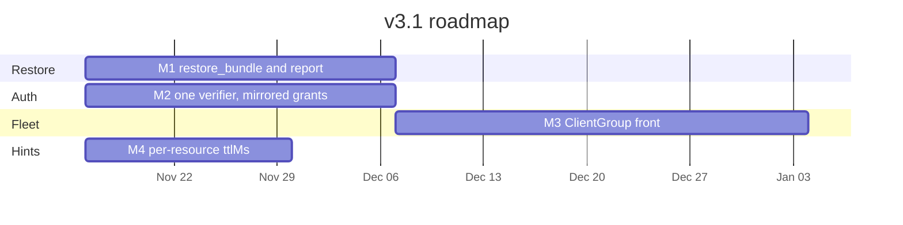

# v3.1 Design and Roadmap

> Status: M4 (cache hints) and M1 (restore) are on main. M2 (identity) and M3 (fleet) remain open.
> Baseline: `3.0.0` on `main`.
> Companion: [v3.0 design](v3-roadmap.md), which deferred the four items below.

v3.1 adds the behaviour v3.0 left on the far side of a thin interface. Four modules,
one minor release. Editions, the task backend, and the Schema Registry HTTP client
stay as they are.

1. **Restore.** Read an export document back into a registry.
2. **Identity and machine clients.** One resource-server validator for human access
   tokens, client-credentials tokens, and tokens minted after a SEP-990 ID-JAG exchange.
3. **Fleet.** A front process that routes `registry=` to a shard through FastMCP
   `ClientGroup`, for fleets that do not fit in eight environment variables.
4. **Cache hints.** A per-resource SEP-2549 table, including a schema-by-id resource
   that can carry a long TTL.

## 1. Goals and non-goals

### Goals

- An admin task that applies an `export_global`, `export_context`, or `export_subject`
  document to one named registry, dry-run unless told to write, preserving schema ids.
- `guided_disaster_recovery` names that task. The planner does not write.
- Accept client-credentials access tokens and SEP-990 access tokens with the same
  verifier that already accepts authorization-code tokens.
- Advertise `client_credentials` and `urn:ietf:params:oauth:grant-type:jwt-bearer`
  only when the upstream authorization server lists them.
- Serve hundreds of registries from a front process that holds no registry passwords.
  The model-facing catalog stays the edition catalog. Tools keep `registry=`.
- Emit a positive `ttlMs` where the data allows it, and `0` where a cached copy
  would be wrong. Clients that ignore hints behave as they do today.

### Non-goals

- No second bundle format. `export_version` stays whatever the exporter already writes.
- No authorization server in this process, and no ID-JAG exchange. SEP-990's client
  adapter (`IdentityAssertionOAuthProvider`) stays on the MCP client.
- No per-registry tool catalog. `ClientGroup`'s `{member}_{tool}` prefix stays inside
  the shard adapter.
- No mixed process that holds some registry passwords and proxies the rest.
- `migrate_schema` stays the live-to-live copy of one subject. Restore's source is
  the document.
- No change to lint configuration, the three editions, or `TasksExtension`.
- No cache-store inside the server. The client caches. The server emits hints.
- No grant-class type on the caller-facing principal, and no per-IdP branch.

## 2. Restore

### 2.1 Interface

```python
async def restore(
    bundle: Mapping[str, Any],
    target: str,
    fleet: Fleet,
    *,
    apply: bool = False,
    accept_new_ids: bool = False,
    context: str | None = None,
    subject: str | None = None,
) -> RestoreReport:
    ...
```

`RestoreReport.status` is `dry_run`, `applied`, `incomplete`, `confirmation_required`,
or `rejected`. The report also carries `created`, `skipped`, `conflicts`, and
`id_preservation` (`preserved`, `import_required`, or `new_ids`).

The MCP tool is `restore_bundle`. Admin edition, scope `admin`, destructive,
`task=True`. It passes the process's `Fleet` in. Tests pass a recording fleet and
open no socket.

`apply` defaults to false, so the common call previews. `accept_new_ids` is the
retry after `confirmation_required`. Schema-id preservation is the behaviour of
every other call. The operator does not pass an IMPORT-mode flag.

`context` and `subject` narrow the document. `subject` requires `context`. Both
default to the whole bundle.

### 2.2 Document contract

A bundle is a dict in one of three shapes:

| Source | Shape |
|---|---|
| `export_global` | `contexts`, `default_context`, optional `global_config` / `global_mode` |
| `export_context` | `context`, `subjects`, optional `global_config` / `global_mode` |
| `export_subject` | `subject`, `versions`, optional `config` |

Recognition is the shape, not the stamp. `export_subject`, `export_context`, and
`export_global` omit `metadata` entirely when `include_metadata=False`, so a
missing `export_version` is a document those tools already emit. Restore accepts
it. When the stamp is present it is recorded on the report. Today's writers use
the literal `"1.7.0"` (`schema_registry_common`) or `__version__`
(`export_context` and `export_global` in `export_tools.py`). Neither stamp is a
gate. A later incompatible shape gets a new version and a new row here.

Rejected before any HTTP, with `status=rejected`:

- a string (Avro IDL)
- a dict whose only useful key is `error`
- a bare `export_schema` object, which has no subject history

### 2.3 Write order and schema ids

Order is fixed: contexts, then subjects with a referenced subject first, then
versions ascending, then compatibility config, then mode.

`apply=False` writes nothing and does not change mode. It still reports whether
IMPORT mode would be required.

`apply=True` opens IMPORT mode for the version writes, then writes the previous
mode again, including when a later step fails (`incomplete`). A retry of the
same bundle skips a version whose schema id and body already match, and reports
a conflict when that id exists with a different body. The conflict is not
overwritten.

If IMPORT mode cannot be set, nothing is written and the status is
`confirmation_required`. The retry is the same call with `accept_new_ids=True`,
which registers new schema ids and lists them on the report.

`restore_bundle` names one target registry, so a front dispatches the whole tool
call to the shard that owns it. The IMPORT window runs on that process. It is
the same helper `migration_tools.py` already uses: `session.put` of mode
`IMPORT` (around line 560) and the restore of the previous mode (around line
837). M1 extracts that helper. `restore` and `migrate_schema` both call it.
The public `register_schema` tool does not grow `schema_id` or `version`. Those
parameters would be an editor-catalog change, and the editor edition cannot
open IMPORT mode.

VIEWONLY stays in `GuardedSession` on the process that holds the registry.
Restore grows no allowlist. A write against a VIEWONLY registry comes back
`rejected`.

### 2.4 Who calls it

`guided_disaster_recovery` stays the planner for backup target and schedule. Its
verify step names `restore_bundle` and does not call it. One tool writes. This
matches `guided_schema_evolution`, which returns a plan and leaves registration
to `register_schema`.

`migrate_schema` keeps its live-to-live interface. It needs a source registry
online. Restore needs a document. They share the IMPORT helper and nothing else.

### 2.5 What stays inside

Context creation, reference order, the IMPORT window, mode restore on failure,
and skip-if-equal. Callers see the report.

The task backend is the existing `TasksExtension`. Restore does not grow a task port.

## 3. Identity and machine clients

This process stays a resource server. `AUTH_ISSUER_URL` stays an external
authorization server. An enterprise client exchanges an ID-JAG at that server
(SEP-990, RFC 7523 `urn:ietf:params:oauth:grant-type:jwt-bearer`) and presents
the access token here. This module never sees the ID-JAG.

### 3.1 Interface

```python
@dataclass(frozen=True)
class Principal:
    scopes: frozenset[str]    # read / write / admin, already expanded
    subject: str | None
    client_id: str | None

async def authenticate(token: str, *, resource: str | None = None) -> Principal: ...

async def advertised_grants() -> tuple[str, ...]: ...
```

`authenticate` checks signature, `iss`, `exp`, and audience. At least one of
`sub`, `client_id`, or `azp` is present. `sub` alone is not required, so a
client-credentials token whose subject is the client id passes. Scopes stay
`read` / `write` / `admin`. Edition stays a separate gate. A token with scope
`admin` does not raise a viewer process to admin.

The tool gate after M2 is `fastmcp.server.auth.require_scopes`, which
`EditionGate` already attaches from the catalog scope. The verifier expands
scopes onto the `AccessToken` it returns: `admin` yields `{admin, write, read}`
and `write` yields `{write, read}`. FastMCP's check is membership, so an
admin-only token has to carry `read` on that object or `require_scopes("read")`
rejects it. "Already expanded" on `Principal.scopes` means that same set.
`oauth_provider.require_scopes`, the wrapper `kafka_schema_registry_unified_mcp.py`
imports and stacks on the tool functions, goes away with the second parse.
Today's `expand_scopes` reads a `requires` key that `SCOPE_DEFINITIONS` never
sets, so the hierarchy is described on the scope entries and is not applied.
M2 makes it real on the access token.

PKCE is not read off the access token. `validate_pkce_requirements` already
returns true for every token, because the proof was checked at issuance.
`authenticate` does not grow a second copy of that check.

`advertised_grants` is the intersection of upstream `grant_types_supported` with
`authorization_code`, `client_credentials`, and
`urn:ietf:params:oauth:grant-type:jwt-bearer`. A grant the issuer does not list
is not added. When that intersection contains the jwt-bearer URN, the
protected-resource metadata advertises the enterprise-managed authorization
extension. That is this server's piece of SEP-990.

### 3.2 One verifier

Today two validators run. FastMCP's `JWTVerifier` accepts the bearer token, then
`require_scopes` calls `validate_token_comprehensive`, which requires `sub` and
builds the key with `RSAAlgorithm.from_jwk`. v3.1 deletes the second parse.
`OAuth21BearerAuthProvider` is the only verifier. Algorithms follow the issuer's
JWKS, including EdDSA when the issuer publishes it.

Grant class is a table inside that verifier. It is not a type on `Principal`
and not a port.

| `gty` | Identity required | PKCE |
|---|---|---|
| `authorization_code` | `sub` | Issuance rule. Discovery must advertise `S256`. The token is not rejected for lacking a verifier claim. |
| `client_credentials` | any one of `sub`, `azp`, `client_id` | Does not apply. |
| `urn:ietf:params:oauth:grant-type:jwt-bearer` | `sub` (the subject the authorization server put on the access token) | Does not apply. |
| absent | any one of `sub`, `azp`, `client_id` | Does not apply. |

Issuers omit `gty`. The absent row is the common case, and that is intended.
A token with no `gty` never reaches the `authorization_code` row, so a human
token that carries `azp` and no `sub` is accepted. The `authorization_code` and
jwt-bearer rows apply only when the token's `gty` is that value. The resource
server does not guess a grant in order to demand `sub`.

### 3.3 Issuer port

Discovery and JWKS are one port, injected when the verifier is built. Callers of
`authenticate` do not see it.

- `HttpAuthorizationServer` fetches `AUTH_ISSUER_URL` and the JWKS URI. Production.
- `FakeAuthorizationServer` returns canned metadata and a local JWKS. Tests.

A quiet upstream fails closed. No synthesized grant list, except the existing
GitHub document, which has no discovery endpoint and is not a pattern for
another provider.

## 4. Fleet

`MultiRegistryManager` loads at most eight registries from
`SCHEMA_REGISTRY_NAME_N` / `SCHEMA_REGISTRY_URL_N`. A fleet of hundreds cannot
be eight environment variables and one credential set. FastMCP `ClientGroup`
holds one MCP client per shard. Each client negotiates its own protocol era.

### 4.1 One role per process

Startup selects one adapter.

| Role | Adapter | Credentials |
|---|---|---|
| This process owns the registries (today, one to eight) | `InProcessFleet` wrapping `MultiRegistryManager` | In this process |
| This process is the front | `ClientGroupFleet` | None. Shard URLs and the directory only. |
| Tests | `RecordingFleet` | None. Stores `(tool, arguments)`. |

A name is never both local and remote. A front does not load
`SCHEMA_REGISTRY_USER` or `SCHEMA_REGISTRY_PASSWORD` for a registry a shard owns.
`VIEWONLY` is enforced on the process that owns the registry.

The directory is `registry name → shard member`. It is environment configuration,
identical on every replica. The front holds one `Client` per shard inside the
`ClientGroup`. Auth on that client is a per-request provider: each `dispatch`
reads the inbound bearer from the current request context and sets
`Authorization` on that outbound call. The pool is one client per shard.
Shards trust the same `AUTH_ISSUER_URL`. The front does not mint a token. A
context with no bearer sends no `Authorization`, and a shard with auth enabled
rejects the call. Any replica can serve the next request because the directory,
not a connection, decides the shard.

### 4.2 Interface

```python
class Fleet:
    async def dispatch(self, tool: str, arguments: Mapping[str, Any]) -> Any: ...
    def names(self) -> list[str]: ...
```

`InProcessFleet.dispatch` runs the tool body already registered in this process.
`ClientGroupFleet.dispatch` resolves the member from the directory, asks
`ClientGroup.resolve_tool` for that member's route, and calls
`route.upstream_name` on `route.client`. The prefixed name is how the group
lists tools. It is not parsed. A registry name that contains `_` cannot collide
with the separator, because nothing splits the string. The model sees one
catalog. `{shard}_list_subjects` is not registered on the front.

Routing:

- A tool whose registry names all sit on one shard runs there, as that tool,
  with the same arguments. Single-registry tool bodies stay on the shard.
  The front does not reimplement them.
- `list_registries` returns `names()`. It does not fan out.
- `compare_registries`, `find_missing_schemas`, and `migrate_schema` name two
  registries. On a front they run in this process and call `dispatch` once per
  registry. A cross-shard migrate is `export_subject` on the source shard and
  `restore` on the target shard.
- The outbound bearer is the one the per-request auth provider attached
  (section 4.1).
- An unknown registry fails the way `get_registry` fails today, before a call
  leaves the process.

### 4.3 Why dispatch, and not a method per registry call

A port with one method per Schema Registry operation (`list_subjects`,
`register_schema`, `update_mode`, and the rest) looks precise and forces every
tool onto it. Those operations already exist as tools on the shard. Re-declaring
them, then implementing them twice, duplicates the catalog editions just
collapsed. `get_registry() -> RegistryClient` is smaller and cannot be
implemented for a shard: the front would be holding an HTTP client whose
password lives elsewhere, and `migration_tools.py` already uses
`target_client.session.put` on that client.

`dispatch` is the operation the front actually performs: send this tool, with
this `registry`, to the member that owns it.

Tools on an in-process deployment keep calling `RegistryClient` inside
`InProcessFleet`. They are not rewritten to a 25-method protocol.

## 5. Cache hints

One in-process table. Tests read it directly. No port, no decorator, no
operator override. A second place for the same number will drift.

FastMCP 4's `cache_ttl` and `cache_scope` are constructor settings. One positive
value, in seconds, applies to `tools/list`, `prompts/list`, `resources/list`,
`resources/templates/list`, `resources/read`, and `server/discover`. There is no
per-component argument. `cache_ttl` must be positive, so the constructor cannot
emit `ttlMs` 0. `apply_cache_hint` fills `ttlMs` and `cacheScope` on each
cacheable result and leaves a field the result already carries.

`get_fastmcp_config` therefore keeps `cache_ttl=60` for the list methods and
for `server/discover`. `server/discover` is on that FastMCP list. SEP-2549 names
the five list and read methods and does not name `server/discover`. Sixty
seconds is `ttlMs` 60000 on the wire. Scope stays `private` when auth is on and
`public` when auth is off, because the edition catalog is the same for every
caller of a process only when scopes cannot filter it.

Per-resource rows are not constructor settings. One wrapper around the SDK's
`resources/read` request handler looks the URI up in the table and sets
`ttlMs` and `cacheScope` on the `ReadResourceResult` FastMCP produced. The
runner's `apply_cache_hint` fills only fields the handler left unset, so the
stamped values win over the 60-second default. FastMCP's own
`Middleware.on_read_resource` is not the hook: it returns a `ResourceResult`
that is converted to the wire result after the middleware chain, so the cache
fields cannot be set there. Today
`registry://{name}/tasks` and `registry://{name}/migrations` inherit that
default and advertise a minute of freshness. M4 corrects that. It does not only
add hints.

`ttlMs` of 0 means the client should treat the result as stale. A positive
value means fresh for that many milliseconds. `private` means the same
authorization context only.

| Target | Where the hint is set | ttlMs | cacheScope |
|---|---|---|---|
| `tools/list`, `prompts/list`, `resources/list`, `resources/templates/list` | constructor | 60000 | `public` when auth is off, `private` when auth is on |
| `server/discover` | constructor (FastMCP, not SEP-2549) | 60000 | same as the list row |
| `schema://{name}/ids/{schema_id}` | `resources/read` middleware | 86400000 | `private` |
| `schema://…/{subject}` and the context form (latest) | `resources/read` middleware | 15000 | `private` |
| `subject://…/config`, `subject://…/mode`, `registry://…/config`, `registry://mode/…` | `resources/read` middleware | 15000 | `private` |
| version lists and the other collection resources | `resources/read` middleware | 60000 | `private` |
| `registry://{name}/tasks`, `registry://{name}/migrations` | `resources/read` middleware | 0 | `private` |
| any other `resources/read` | `resources/read` middleware | 0 | `private` |

`schema://{name}/ids/{schema_id}` is new, viewer edition, scope `read`.
Schema-by-id is immutable, and today it is only the `get_schema_by_id` tool.
`tools/call` is not a SEP-2549 method, so a long TTL on that tool result would
be a hint clients are not required to honour. The resource is where the 24-hour
hint lives.

Latest, mode, and config stay at 15 seconds because they change during a
conversation and a single turn should be able to reuse a read. Tasks and
migrations are stale on arrival. Schema bodies stay `private` even with auth
off, because they sit behind registry credentials. List results stay `private`
whenever scopes can change what a caller sees, and `public` only when auth is
off and the edition catalog is the same for every caller of that process.

## 6. Milestones

M1, M2, and M4 are independent. M3 follows M1, because cross-shard migrate uses
restore.



### M1 — Restore, ships as `3.1.0-alpha.1`

- `restore` and `restore_bundle` in the admin catalog.
- `guided_disaster_recovery` names `restore_bundle` in its verify step and does
  not call it.
- Extract the IMPORT window from `migration_tools.py`. `restore` and
  `migrate_schema` call it. The public `register_schema` tool is unchanged.
- Exit: recording-fleet tests cover dry-run, IMPORT confirmation, skip-present,
  conflict, VIEWONLY, an Avro IDL string, an error dict, a missing
  `export_version`, and both stamps the exporters write today.

### M2 — Identity, ships as `3.1.0-beta.1`

- Delete `validate_token_comprehensive` as a second parse. One verifier.
- Drop `oauth_provider.require_scopes` and the decorators in
  `kafka_schema_registry_unified_mcp.py`. `EditionGate` keeps attaching
  `fastmcp.server.auth.require_scopes`. The verifier returns expanded scopes
  on the access token.
- `advertised_grants` and the SEP-990 metadata bit.
- Exit: fixture-issuer tests for an authorization-code token, a
  client-credentials token with no user `sub`, a jwt-bearer token, a missing
  `gty`, and a grant list that omits jwt-bearer so the metadata omits it too.

### M3 — Fleet, ships as `3.1.0-rc.1`

- `InProcessFleet`, `ClientGroupFleet`, `RecordingFleet`. Role chosen at startup.
- Front forwards single-registry tools. Compare and cross-shard migrate call
  `dispatch`. The front has no registry password in its environment.
- Exit: recording-fleet test asserts `resolve_tool` is called with the member
  route, the upstream tool name is unprefixed, `registry` is unchanged, and a
  cross-shard compare does not load a password. A two-shard smoke test is the
  release check. The per-request auth provider is tested by two contexts on
  one pooled client sending two different bearers.

### M4 — Cache hints, ships as `3.1.0`

- Hint table. Constructor `cache_ttl` stays 60 for lists and `server/discover`.
  `resources/read` middleware stamps the per-resource rows, including `ttlMs` 0
  for tasks and migrations.
- `schema://{name}/ids/{schema_id}` registered for the viewer edition.
- Exit: table tests for the rows in section 5, plus a middleware test that a
  task resource result carries `ttlMs` 0 rather than the constructor's 60000.
  An auth-on deployment still reports list hints as `private`. Docs and
  CHANGELOG `[3.1.0]`.

## 7. Files

**M1.** New `restore.py`. `tool_catalog.py`, `kafka_schema_registry_unified_mcp.py`,
`workflow_mcp_integration.py` (planner text only), `migration_tools.py` (extract
the IMPORT helper), `tests/test_restore.py`.

**M2.** `oauth_provider.py`, `kafka_schema_registry_unified_mcp.py` (drop the
`oauth_provider.require_scopes` decorators), `remote-mcp-server.py`
(protected-resource metadata), `tests/test_oauth_discovery.py` and a
fixture-issuer test.

**M3.** New `fleet.py`. Startup in `kafka_schema_registry_unified_mcp.py` chooses
the adapter. Helm values for the directory and shard URLs. `tests/test_fleet.py`.
Single-registry tool modules stay on the shard. Compare, find-missing, and
migrate call `dispatch` when the process is a front.

**M4.** New `cache_hints.py`. `oauth_provider.get_fastmcp_config` keeps the
positive list hint. `cache_hints.install_read_resource_hints` wraps the
`resources/read` handler; `kafka_schema_registry_unified_mcp.py` calls it
after registration and adds the schema-by-id resource.
`tests/test_cache_hints.py`.

## 8. Test surface

Tests call the same interface callers call.

| Module | Call under test | Stand-in |
|---|---|---|
| Restore | `restore(...)` | `RecordingFleet` |
| Identity | `authenticate`, `advertised_grants` | `FakeAuthorizationServer` |
| Fleet | `dispatch`, `names` | `RecordingFleet` for routing; `InProcessFleet` against the Docker registry for one integration test |
| Cache hints | the table lookup | none |

A test that reaches past these interfaces into HTTP paths, JWKS fetching, or
`ClientGroup.resolve_tool` routing is testing the adapter, and belongs next to
that adapter.
